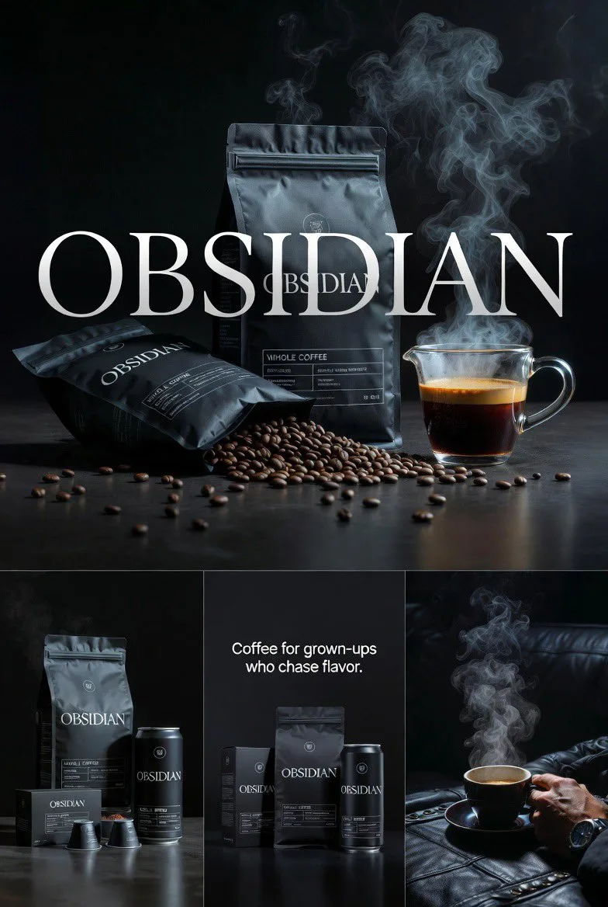

# Chase Dimond | Email Marketing Nerd 📧 — by @ecomchasedimond

[← Back to Examples from X](../../EXAMPLES.md) · Category: Poster Design · Model: `GPT Image`

<a href="https://x.com/ecomchasedimond/status/2048598185841734064"></a>

Original post: **[@ecomchasedimond on X](https://x.com/ecomchasedimond/status/2048598185841734064)** · Creator: [Chase Dimond | Email Marketing Nerd 📧](https://x.com/ecomchasedimond)

## Prompt

```text
Create four connected premium realistic editorial images for OBSIDIAN coffee. Dark cinematic grown-up vibe like high-end sportswear or coffee campaigns. Dramatic but grounded studio lighting, realistic textures, clean composition. Image 1: Hero poster with ‘OBSIDIAN’ and premium coffee display with steam and beans. Image 2: Product lineup - bags, cans, capsules. Image 3: Packaging close-up + tagline ‘Coffee for grown-ups who chase flavor.’ Image 4: Lifestyle steaming cup shot. Highly polished, sharp, realistic materials, consistent branding, no surreal effects
```

## Try it

Paste the prompt into **[vinano.ai](https://vinano.ai?utm_source=github&utm_medium=readme&utm_campaign=awesome-image-video-prompts-updating&utm_content=x-page-try)** to generate your own version.

> The image and prompt belong to [@ecomchasedimond](https://x.com/ecomchasedimond) and are shown here with credit for reference. Creators can ask for changes or removal by opening an issue.
