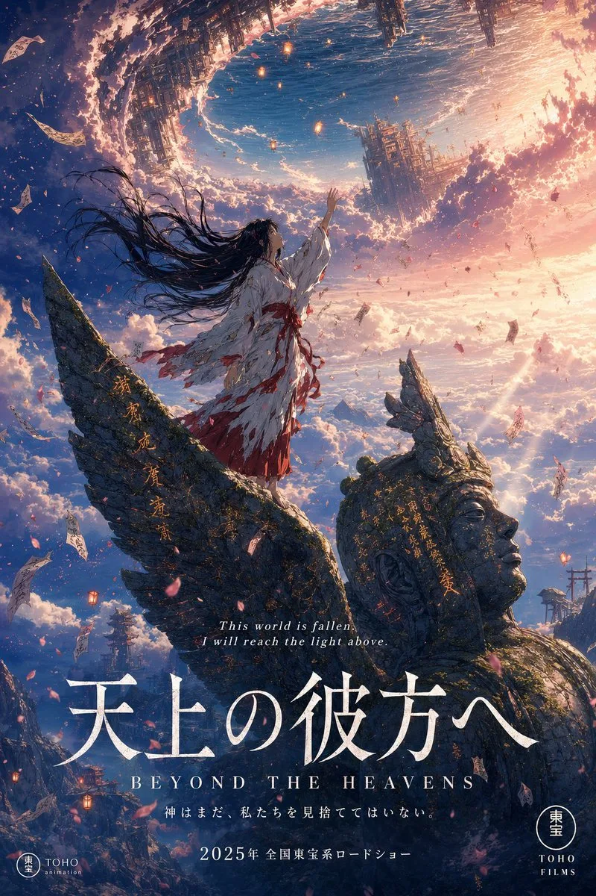

# Oogie — by @oggii_0

[← Back to Community Examples](../../EXAMPLES.md) · Category: Poster Design · Model: `GPT Image`

<a href="https://x.com/oggii_0/status/2047890555250610457"></a>

Source: **[@oggii_0 on X](https://x.com/oggii_0/status/2047890555250610457)** · Creator: [Oogie](https://x.com/oggii_0)

## Prompt

```text
A stunning anime theatrical movie poster in portrait format. Studio Ghibli meets Makoto Shinkai visual language. A teenage girl in a tattered white shrine maiden robe stands on the wing of a crumbling giant stone deity — an ancient colossus covered in moss and glowing golden kanji script, slowly falling through a sea of clouds. Her long black hair streams upward against gravity. She reaches one hand toward the sky where a vast celestial rift tears open the heavens — beyond it, an inverted ocean floats above the clouds, ancient wooden cities hanging upside down from its surface, lanterns drifting like stars. The sky transitions from deep twilight blue at the bottom to a luminous peach and rose gold at the top. Volumetric god rays pierce through cloud layers. Cherry blossom petals and torn paper talismans spiral everywhere. Her expression is calm determination. Art style: hand-drawn 2D animation, ultra-detailed background painting, expressive linework, rich cel shading. Palette: deep indigo, peach, rose gold, warm amber, soft white. Title in large elegant Japanese kanji at the bottom with English subtitle beneath in a clean modern font. Tagline in small white italic text above the title. Mood: mythological, spiritual, bittersweet wonder. Theatrical release quality, Toho Films.
```

## Try it

Paste the prompt into **[vinano.ai](https://vinano.ai?utm_source=github&utm_medium=readme&utm_campaign=awesome-image-video-prompts-updating&utm_content=x-page-try)** to generate your own version.

> The image and prompt belong to @oggii_0 ([original post](https://x.com/oggii_0/status/2047890555250610457)) and are shown here with credit for reference. Creators can ask for changes or removal by opening an issue.
