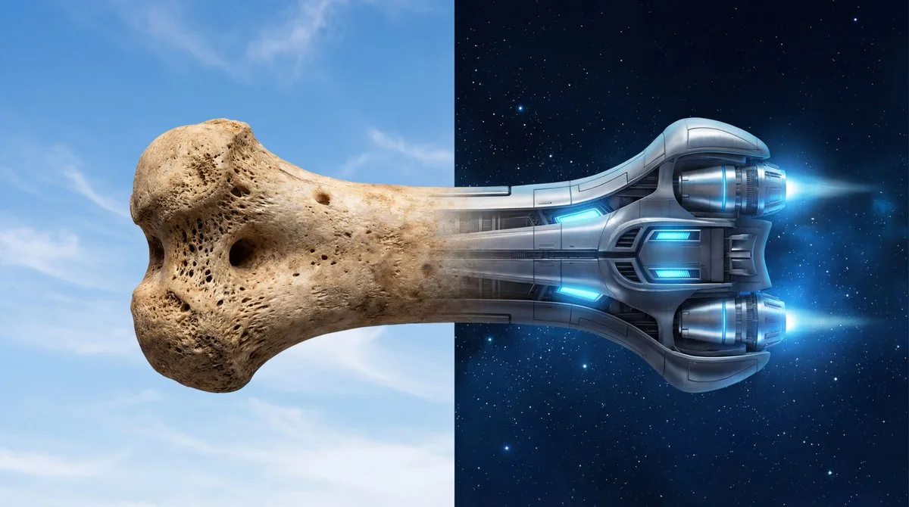

# Umesh — by @umesh_ai

[← Back to Community Examples](../../EXAMPLES.md) · Category: Illustration & 3D · Model: `GPT Image`

<a href="https://x.com/umesh_ai/status/2009878072565346585"></a>

Source: **[@umesh_ai on X](https://x.com/umesh_ai/status/2009878072565346585)** · Creator: [Umesh](https://x.com/umesh_ai)

## Prompt

```text
A photorealistic image, split down the middle. On the left side, a small, detailed bone that touches the center divider, resembling a dog bone set against a clear blue sky with clouds in  background. On the right side, the bone seamlessly transitions into a detailed, futuristic stunning spacecraft, maintaining the line and shape of the bone against a deep  space background scattered with stars. The spacecraft extends to the right edge, designed with elements that suggest a continuation of the bone's structure. The transition should be smooth, illustrating a creative blend where the organic shape of the bone becomes one with the mechanical structure of the spacecraft, set against a neutral background to emphasize the two subjects.
```

## Try it

Paste the prompt into **[vinano.ai](https://vinano.ai?utm_source=github&utm_medium=readme&utm_campaign=awesome-image-video-prompts-updating&utm_content=x-page-try)** to generate your own version.

> The image and prompt belong to @umesh_ai ([original post](https://x.com/umesh_ai/status/2009878072565346585)) and are shown here with credit for reference. Creators can ask for changes or removal by opening an issue.
