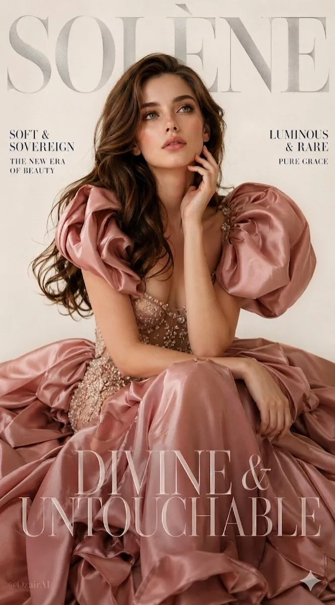

# Ozair AI — by @Ozayrr_irl

[← Back to Community Examples](../../EXAMPLES.md) · Category: Poster Design · Model: `GPT Image`

<a href="https://x.com/Ozayrr_irl/status/2047541284005453933"></a>

Source: **[@Ozayrr_irl on X](https://x.com/Ozayrr_irl/status/2047541284005453933)** · Creator: [Ozair AI](https://x.com/Ozayrr_irl)

## Prompt

```text
A breathtaking luxury fashion magazine cover. Large bold silver serif brand name "SOLÈNE" elegantly placed at the very top of the frame, slightly transparent and overlapping the model's hair — exactly like a high-end fashion magazine masthead. Clean cream-white background, seamless studio, soft warm-toned lighting.

A young, extremely cute and beautiful white woman with soft angelic facial features, full lips, big dreamy green eyes with long lashes, and long silky chocolate brown wavy hair cascading freely over both shoulders. She sits gracefully — upper body leaning slightly forward, one arm resting on her knee, the other hand delicately touching her jaw, her gaze looking slightly upward and off-camera with a soft mysterious expression — elegant and effortless.

She wears a dramatic floor-length dusty rose blush satin ballgown with exaggerated sculptural puff shoulders that billow outward like rose petals — the bodice is a sheer champagne silk mesh embroidered with tiny pearl and crystal details, fitted through the waist and blooming into an enormous tiered skirt pooling around her. The fabric catches the light with a soft luminous sheen.

Magazine text overlaid naturally into the composition — left side in deep charcoal navy small serif caps: "SOFT & SOVEREIGN / THE NEW ERA OF BEAUTY" — right side: "LUMINOUS & RARE / PURE GRACE" — bottom of frame in large elegant serif display font, slightly transparent: "DIVINE & UNTOUCHABLE"
Vertical 9:13 format. Ultra photorealistic, 8K, no text overlays, cinematic color grading.
```

## Try it

Paste the prompt into **[vinano.ai](https://vinano.ai?utm_source=github&utm_medium=readme&utm_campaign=awesome-image-video-prompts-updating&utm_content=x-page-try)** to generate your own version.

> The image and prompt belong to @Ozayrr_irl ([original post](https://x.com/Ozayrr_irl/status/2047541284005453933)) and are shown here with credit for reference. Creators can ask for changes or removal by opening an issue.
