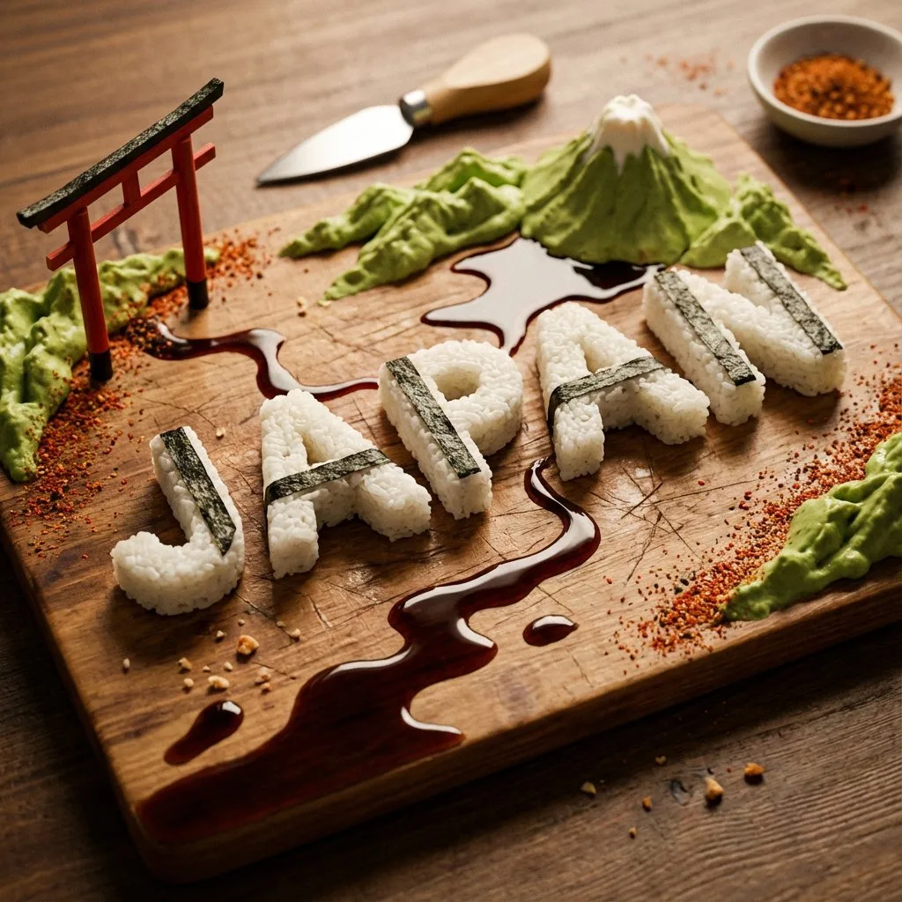

# Gadgetify — by @Gdgtify

[← Back to Examples from X](../../EXAMPLES.md) · Category: Illustration & 3D · Model: `GPT Image`

<a href="https://x.com/Gdgtify/status/2004950904152506497"></a>

Original post: **[@Gdgtify on X](https://x.com/Gdgtify/status/2004950904152506497)** · Creator: [Gadgetify](https://x.com/Gdgtify)

## Prompt

```text
A charcuterie-style board presents JAPAN as an edible sculpture: • Letters carved from compact sushi-rice blocks wrapped with nori trim • Rivers and lakes painted in glossy soy-mirin reduction • Mountain ranges piped in smooth wasabi-avocado mousse (Mount Fuji peak highlighted) • Coastlines dusted with shichimi togarashi spice mix Add one iconic red Torii-gate bamboo skewer garnish anchoring the composition. Polarised studio softbox lighting, 50 mm prime, f/4, shallow depth; crumbs, knife marks, and wood-grain preserved. Rendered in Cinema 4D + Octane, 16 : 9 warm tabletop scene. (NO text, flags, or extra objects outside the board.)
```

## Try it

Paste the prompt into **[vinano.ai](https://vinano.ai?utm_source=github&utm_medium=readme&utm_campaign=awesome-image-video-prompts-updating&utm_content=x-page-try)** to generate your own version.

> The image and prompt belong to [@Gdgtify](https://x.com/Gdgtify) and are shown here with credit for reference. Creators can ask for changes or removal by opening an issue.
