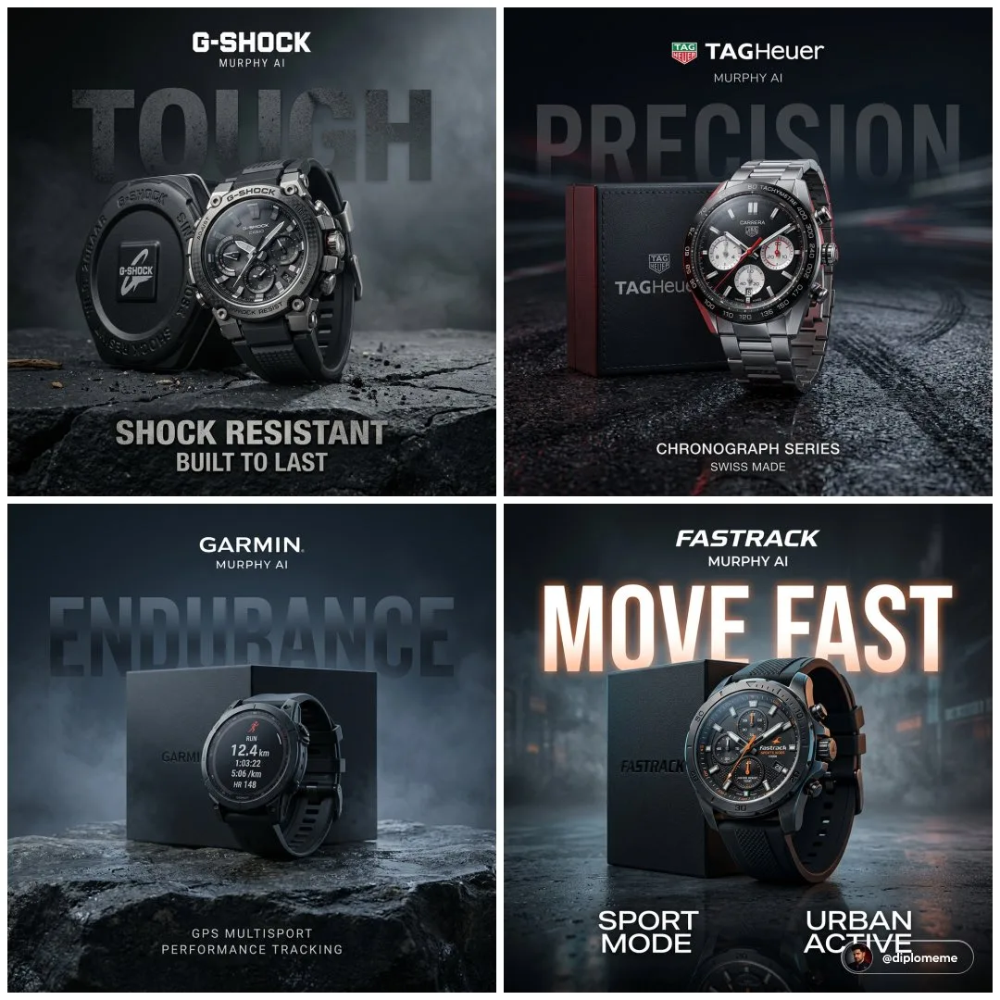

# ᴍᴜʀᴘʜʏ — by @Diplomeme

[← Back to Examples from X](../../EXAMPLES.md) · Category: Poster Design · Model: `GPT Image`

<a href="https://x.com/Diplomeme/status/2047170094716051776"></a>

Original post: **[@Diplomeme on X](https://x.com/Diplomeme/status/2047170094716051776)** · Creator: [ᴍᴜʀᴘʜʏ](https://x.com/Diplomeme)

## Prompt

```text
TAG Heuer — Track Surface (REAL, NOT FAKE)

High-end commercial watch advertisement, TAG Heuer chronograph, single watch leaning against its box, centered composition, slight front three-quarter angle

environment: real wet asphalt surface inspired by race track texture, subtle tire marks, light moisture, NOT full scene

background: soft dark depth with slight motion blur light streak hints, minimal, not literal track

lighting: controlled studio lighting with strong key for dial clarity, subtle red rim light for racing identity, crisp reflections on metal and glass

composition: tight grouping, grounded, realistic spacing

perspective typography (primary): large “PRECISION” in background, soft perspective, slightly diffused, low opacity, blending into depth

secondary typography:
“CHRONOGRAPH SERIES”
“SWISS MADE”

branding: logo top center, “MURPHY AI” beneath

surface: wet asphalt reflection, controlled, not exaggerated

color palette: black, steel, red accents

ultra-realistic materials (brushed metal, sapphire reflections, lume details)

1:1 square format

Casio G-Shock — Rugged Ground (LIKE YOUR CHARCOAL SHOT)

High-end commercial watch advertisement, G-Shock rugged watch, single watch leaning against its box, centered

environment: controlled rough stone / cracked surface with dust particles, minimal debris (like your Nivea charcoal setup)

background: dark soft gradient with slight haze, no literal landscape

lighting: directional studio lighting, strong highlights on edges, controlled shadow depth

composition: grounded, tight product grouping

perspective typography (primary): bold “TOUGH” in background, slightly broken texture, soft perspective depth, low opacity

secondary typography:
“SHOCK RESISTANT”
“BUILT TO LAST”

branding: logo top center, “MURPHY AI” beneath

surface: matte rough texture, minimal reflection

color palette: charcoal, black, muted tones

ultra-detailed rugged material finish

1:1 square format

Garmin — Outdoor Tech (CONTROLLED, NOT LANDSCAPE)

High-end commercial watch advertisement, Garmin GPS smartwatch, single watch leaning against its box, centered

environment: textured rock surface with subtle moisture and fine dust, clean minimal outdoor feel (not full mountain scene)

background: deep cool gradient with faint mist layers for depth

lighting: soft controlled lighting, cool rim highlights, clean display visibility

composition: tight, balanced, grounded

perspective typography (primary): “ENDURANCE” large in background, geometric, fading into depth with soft haze

secondary typography:
“GPS MULTISPORT”
“PERFORMANCE TRACKING”

branding: logo top center, “MURPHY AI” beneath

surface: natural rock with subtle reflection

color palette: blue-grey, black

ultra-clean product rendering

1:1 square format

Fastrack — Urban Surface (LIKE GARNIER WATER BUT DRY)

High-end commercial watch advertisement, Fastrack sports watch, single watch leaning against its box, centered

environment: dark smooth surface with slight gloss and subtle texture, faint moisture or light reflection, urban tone

background: soft gradient with slight haze, minimal depth

lighting: contrast studio lighting with subtle colored accent reflections, controlled highlights

composition: tight and clean

perspective typography (primary): “MOVE FAST” large in background, soft perspective, slightly glowing edges, integrated subtly

secondary typography:
“SPORT MODE”
“URBAN ACTIVE”

branding: logo top center, “MURPHY AI” beneath

surface: controlled reflection, not mirror-like

color palette: black, grey, subtle accent color

ultra-detailed modern finish
```

## Try it

Paste the prompt into **[vinano.ai](https://vinano.ai?utm_source=github&utm_medium=readme&utm_campaign=awesome-image-video-prompts-updating&utm_content=x-page-try)** to generate your own version.

> The image and prompt belong to [@Diplomeme](https://x.com/Diplomeme) and are shown here with credit for reference. Creators can ask for changes or removal by opening an issue.
