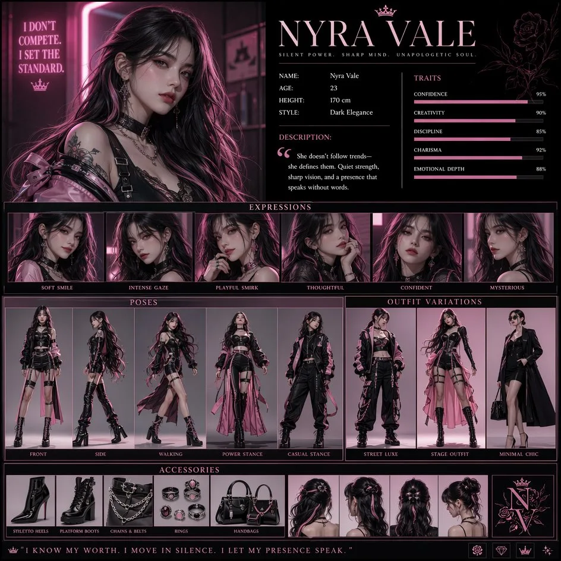

# Cherry 2.O — by @Mind_Boticni

[← Back to Examples from X](../../EXAMPLES.md) · Category: Poster Design · Model: `GPT Image`

<a href="https://x.com/Mind_Boticni/status/2048779320966230339"></a>

Original post: **[@Mind_Boticni on X](https://x.com/Mind_Boticni/status/2048779320966230339)** · Creator: [Cherry 2.O](https://x.com/Mind_Boticni)

## Prompt

```text
Create a high-resolution vertical character concept poster with a luxury pink and white  aesthetic, blending elegance with edgy, modern fashion. The layout should feel like a premium magazine profile with clean sections and perfect grid alignment.

Main subject: A unique young woman (not resembling any real person), with long silky dark hair featuring subtle pink highlights. She has a confident, calm expression with a slightly mysterious aura. She wears a black and pink fusion outfit (mix of streetwear and idol fashion) with glossy textures, lace, and metallic accents. Lighting is soft but dramatic, with neon pink glow against dark tones.

Top section:
Large hero portrait on one side. On the other side, include a sleek profile panel with elegant English text:

Name: Nyra Vale
Age: 23
Height: 170 cm
Style: Dark Elegance

Short description:
“She doesn’t follow trends—she defines them. Quiet strength, sharp vision, and a presence that speaks without words.”

Add a Traits section with stylish progress bars:

Confidence
Creativity
Discipline
Charisma
Emotional Depth

Middle section:
Grid of 5–6 small portraits showing different expressions (soft smile, intense gaze, playful smirk, thoughtful, confident).

Lower sections:

Full-body poses (front, side, walking pose, power stance, casual stance).
Outfit variations (street luxe, stage outfit, minimal chic).
Accessories panel (heels, boots, chains, rings, handbags, hairstyles).

Text tone:
Strong, meaningful, and confident—focused on individuality, self-worth, and silent power. Avoid filler text.

Style:
Ultra-detailed, 4K quality, glossy magazine finish, cinematic lighting, sharp focus, balanced contrast, modern editorial layout, perfectly aligned grid.
```

## Try it

Paste the prompt into **[vinano.ai](https://vinano.ai?utm_source=github&utm_medium=readme&utm_campaign=awesome-image-video-prompts-updating&utm_content=x-page-try)** to generate your own version.

> The image and prompt belong to [@Mind_Boticni](https://x.com/Mind_Boticni) and are shown here with credit for reference. Creators can ask for changes or removal by opening an issue.
