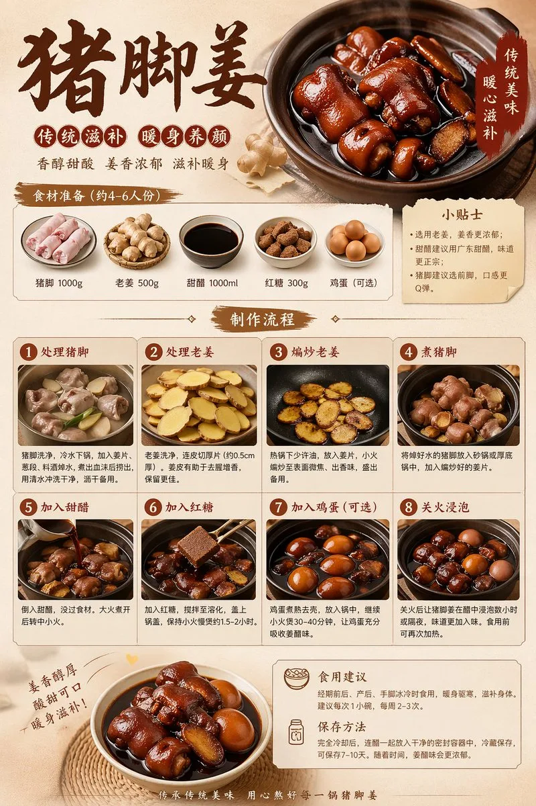

# John — by @johnAGI168

[← Back to Community Examples](../../EXAMPLES.md) · Category: Poster Design · Model: `GPT Image`

<a href="https://x.com/johnAGI168/status/2046995536528445697"></a>

Source: **[@johnAGI168 on X](https://x.com/johnAGI168/status/2046995536528445697)** · Creator: [John](https://x.com/johnAGI168)

## Prompt

```text
Create a [food name] food preparation poster
```

## Try it

Paste the prompt into **[vinano.ai](https://vinano.ai?utm_source=github&utm_medium=readme&utm_campaign=awesome-image-video-prompts-updating&utm_content=x-page-try)** to generate your own version.

> The image and prompt belong to @johnAGI168 ([original post](https://x.com/johnAGI168/status/2046995536528445697)) and are shown here with credit for reference. Creators can ask for changes or removal by opening an issue.
