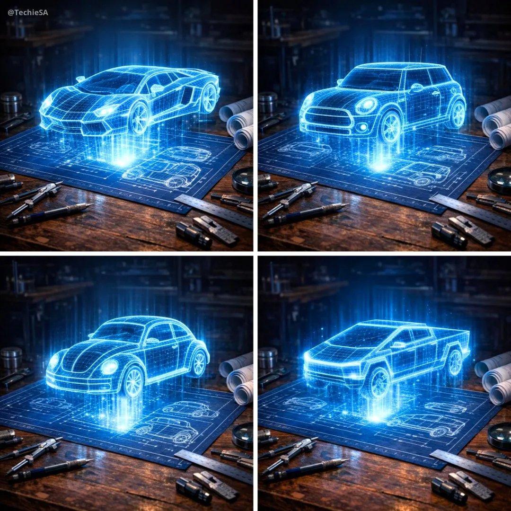

# TechieSA — by @TechieBySA

[← Back to Community Examples](../../EXAMPLES.md) · Category: Illustration & 3D · Model: `GPT Image`

<a href="https://x.com/TechieBySA/status/2009945337788805362"></a>

Source: **[@TechieBySA on X](https://x.com/TechieBySA/status/2009945337788805362)** · Creator: [TechieSA](https://x.com/TechieBySA)

## Prompt

```text
Create a hyper-realistic 3D holographic blueprint projection of a [CAR NAME] emerging as a luminous cyan/blue wireframe model from a dark blue technical blueprint sheet on a wooden workshop table. The car appears as glowing electric blue wireframe lines with grid patterns and transparent surfaces, creating a futuristic holographic effect. The 3D model hovers above the flat blueprint drawings with dramatic lighting and bright cyan glow. Surround with precision drafting tools, compass, rolled blueprints, and technical instruments on dark wooden surface. Dark atmospheric background with studio lighting. Aspect ratio: 1:1 (1080x1080 pixels). Do not include any vehicle logos or brand emblems
```

## Try it

Paste the prompt into **[vinano.ai](https://vinano.ai?utm_source=github&utm_medium=readme&utm_campaign=awesome-image-video-prompts-updating&utm_content=x-page-try)** to generate your own version.

> The image and prompt belong to @TechieBySA ([original post](https://x.com/TechieBySA/status/2009945337788805362)) and are shown here with credit for reference. Creators can ask for changes or removal by opening an issue.
