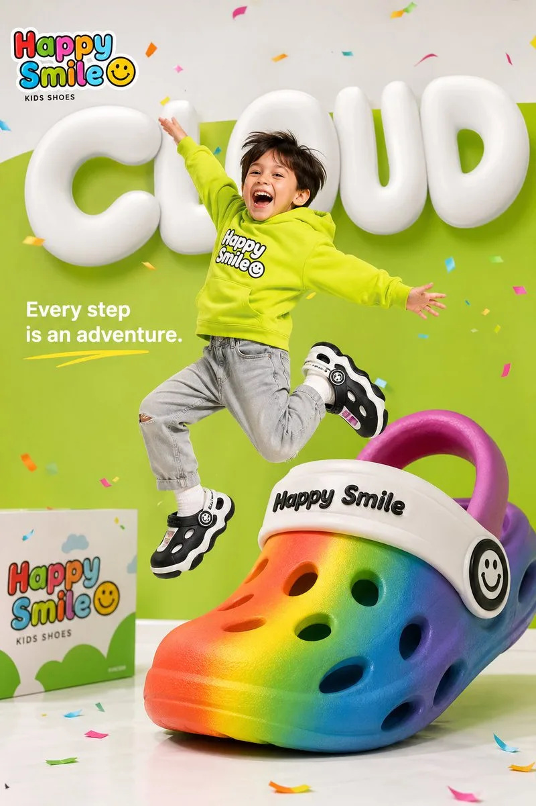

# Al-Shamus — by @im_shahid7

[← Back to Examples from X](../../EXAMPLES.md) · Category: Poster Design · Model: `GPT Image`

<a href="https://x.com/im_shahid7/status/2048726962001379515"></a>

Original post: **[@im_shahid7 on X](https://x.com/im_shahid7/status/2048726962001379515)** · Creator: [Al-Shamus](https://x.com/im_shahid7)

## Prompt

```text
Bright colorful children's shoe brand advertisement for "Happy Smile☺️", happy young child jumping in the air wearing oversized colorful foam  black and white shoes, giant rainbow colored shoe prop in background, bright green and white studio background, playful bubbly bold typography "CLOUD" in background, tagline "Every step 
is an adventure.", confetti falling, fun joyful lighting, 
commercial photography style, ultra HD 8K , Designed with Shamus image 2.
```

## Try it

Paste the prompt into **[vinano.ai](https://vinano.ai?utm_source=github&utm_medium=readme&utm_campaign=awesome-image-video-prompts-updating&utm_content=x-page-try)** to generate your own version.

> The image and prompt belong to [@im_shahid7](https://x.com/im_shahid7) and are shown here with credit for reference. Creators can ask for changes or removal by opening an issue.
