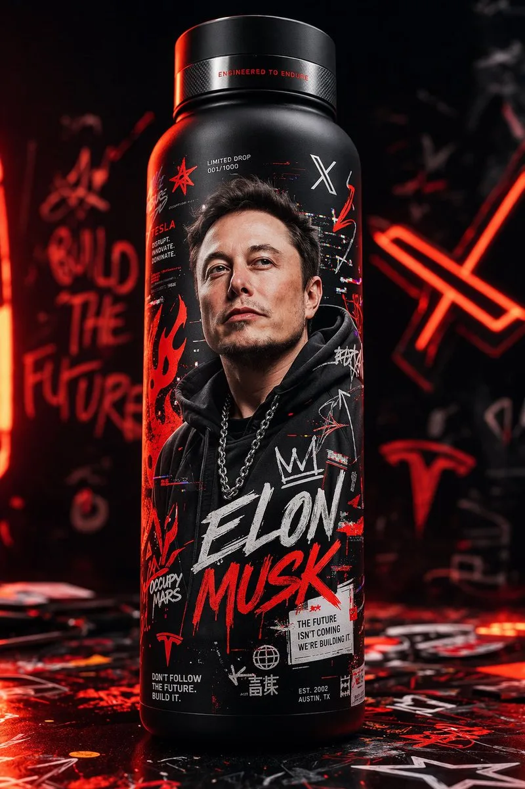

# Duet | AI — by @Sheldon056

[← Back to Community Examples](../../EXAMPLES.md) · Category: Illustration & 3D · Model: `GPT Image`

<a href="https://x.com/Sheldon056/status/2039903864074510712"></a>

Source: **[@Sheldon056 on X](https://x.com/Sheldon056/status/2039903864074510712)** · Creator: [Duet | AI](https://x.com/Sheldon056)

## Prompt

```text
Ultra-realistic 8K hype-brand product shot of a collectible thermal bottle with a sleek matte black finish and bold urban aesthetic. The bottle features a high-detail 3D character based on the attached reference photo, preserving exact facial identity and structure, styled with a confident, edgy expression.
The character wears oversized streetwear (premium hoodie with layered textures) and a reflective silver chain, inspired by high-end hype fashion. The artwork wraps dynamically around the bottle with a slightly distorted, graffiti-inspired layout for a bold visual impact.
Surrounding elements include vibrant pop-art doodles — flames, arrows, stars, scribbles — with neon accents (electric red, orange, subtle glow effects), creating a high-energy, limited-edition drop feel. Add subtle glitch effects, sticker-style overlays, and micro-branding details to reinforce exclusivity.
Material realism: soft-touch matte coating with fingerprint-level texture, contrasted by glossy UV print highlights and metallic reflections. Cinematic studio lighting with strong contrast, rim light glow, and controlled reflections to enhance depth and luxury street appeal.
Shot composition: centered hero product, low-angle perspective for dominance, shallow depth of field, ultra-clean dark or gradient background. Premium commercial photography style mixed with urban fashion campaign energy. Hyper-detailed, photorealistic, high contrast, sharp focus.
```

## Try it

Paste the prompt into **[vinano.ai](https://vinano.ai?utm_source=github&utm_medium=readme&utm_campaign=awesome-image-video-prompts-updating&utm_content=x-page-try)** to generate your own version.

> The image and prompt belong to @Sheldon056 ([original post](https://x.com/Sheldon056/status/2039903864074510712)) and are shown here with credit for reference. Creators can ask for changes or removal by opening an issue.
