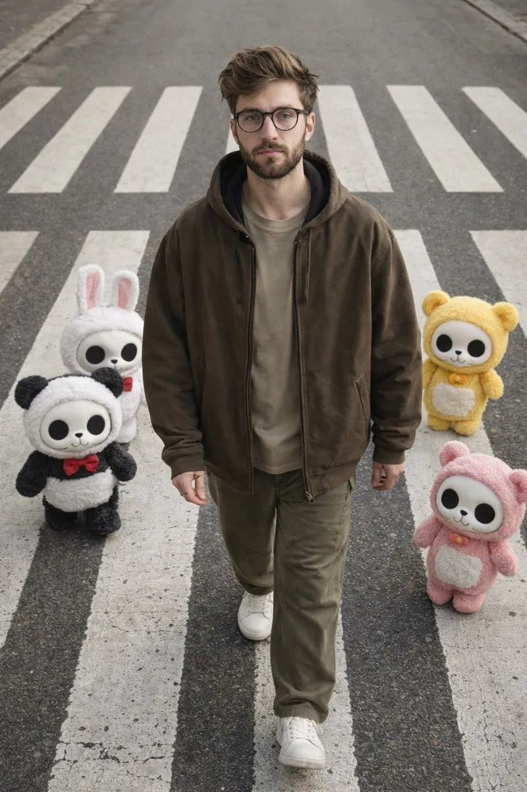

# Duet | AI — by @Sheldon056

[← Back to Examples from X](../../EXAMPLES.md) · Category: Photography · Model: `GPT Image`

<a href="https://x.com/Sheldon056/status/2011274988700205370"></a>

Original post: **[@Sheldon056 on X](https://x.com/Sheldon056/status/2011274988700205370)** · Creator: [Duet | AI](https://x.com/Sheldon056)

## Prompt

```text
A hyper-realistic iPhone RAW photo, vertical 9:16 ratio, candid street photography style with natural daylight, no filter, no cinematic grading, realistic color balance, Pinterest-style artsy realism.
The camera angle MUST MATCH THE REFERENCE IMAGE EXACTLY: a slightly elevated wide-angle perspective looking down toward a zebra crosswalk, similar to a street-level overhead shot, capturing the full crosswalk lines horizontally with the subject positioned at the center and symmetrically surrounded by characters, maintaining the exact spatial relationship and perspective of the reference photo. A young adult man with an athletic and naturally fit build is walking forward mid-step on the zebra crossing, body orientation, walking direction, and pose following the reference precisely, expression calm, neutral, and candid as if casually crossing the street, not posing. Outfit consists of fashionable casual streetwear with relaxed silhouettes: an oversized jacket in earthy muted tones such as brown, olive, or charcoal, a simple inner shirt, loose straight-cut trousers, and clean minimalist sneakers, creating an effortless modern daily-wear look that supports the calm surreal theme. Props include multiple Popmart Skullpanda characters in fluffy costumes placed around the subject in the SAME formation, spacing, and positioning as the reference image, each Skullpanda featuring soft plush textures, rounded proportions, and varied colors, appearing to walk alongside the human subject on the crosswalk. The location is an empty urban street with a clearly visible zebra crossing, realistic asphalt texture with subtle grain and natural wear, no traffic, no extra people, and an identical street layout perspective to the reference. Camera and composition are wide shot and full-body framing with no portrait crop, handheld but steady feel with slight natural imperfections, realistic depth of field keeping both subject and surrounding characters in focus, matching reference scale and depth. Lighting is natural daylight from above with soft consistent shadows on the ground, balanced exposure, no harsh sunlight, and no dramatic contrast. Skin texture is realistic and human, smooth yet visibly porous with natural highlights and subtle imperfections, no airbrushing, no plastic or CGI skin. Negative prompt: different camera angle, low angle, eye-level shot, close-up portrait, cinematic lighting, HDR, oversharpening, overly smooth skin, CGI look, 3D render, cartoon human, face alteration, distorted anatomy, text, watermark, logo.
```

## Try it

Paste the prompt into **[vinano.ai](https://vinano.ai?utm_source=github&utm_medium=readme&utm_campaign=awesome-image-video-prompts-updating&utm_content=x-page-try)** to generate your own version.

> The image and prompt belong to [@Sheldon056](https://x.com/Sheldon056) and are shown here with credit for reference. Creators can ask for changes or removal by opening an issue.
