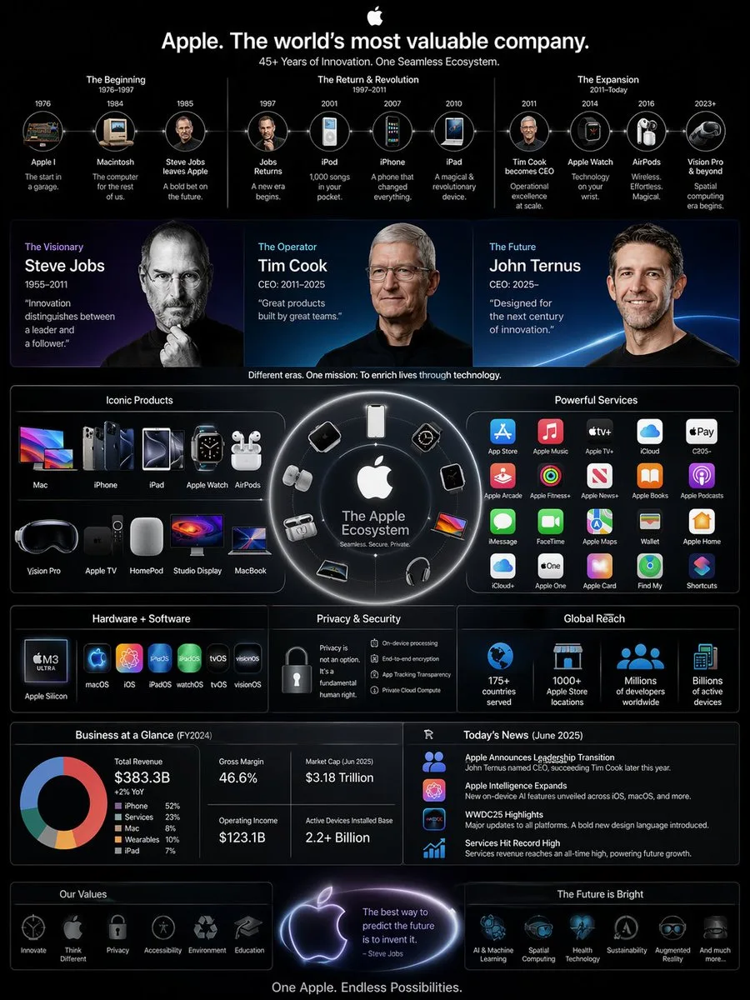

# Jackywine — by @Jackywine

[← Back to Community Examples](../../EXAMPLES.md) · Category: UI & Graphic · Model: `GPT Image`

<a href="https://x.com/Jackywine/status/2046480096471765192"></a>

Source: **[@Jackywine on X](https://x.com/Jackywine/status/2046480096471765192)** · Creator: [Jackywine](https://x.com/Jackywine)

## Prompt

```text
高复杂度信息图：结合今天的新闻，CEO 换成了Ternus，信息图要竖版 3:4要有乔布斯、cook、Ternus 三人头像，以及产品，以及超多苹果服务标志，整体风格偏 WWDC 的苹果风格，完整展现苹果庞大商业帝国
```

## Try it

Paste the prompt into **[vinano.ai](https://vinano.ai?utm_source=github&utm_medium=readme&utm_campaign=awesome-image-video-prompts-updating&utm_content=x-page-try)** to generate your own version.

> The image and prompt belong to @Jackywine ([original post](https://x.com/Jackywine/status/2046480096471765192)) and are shown here with credit for reference. Creators can ask for changes or removal by opening an issue.
