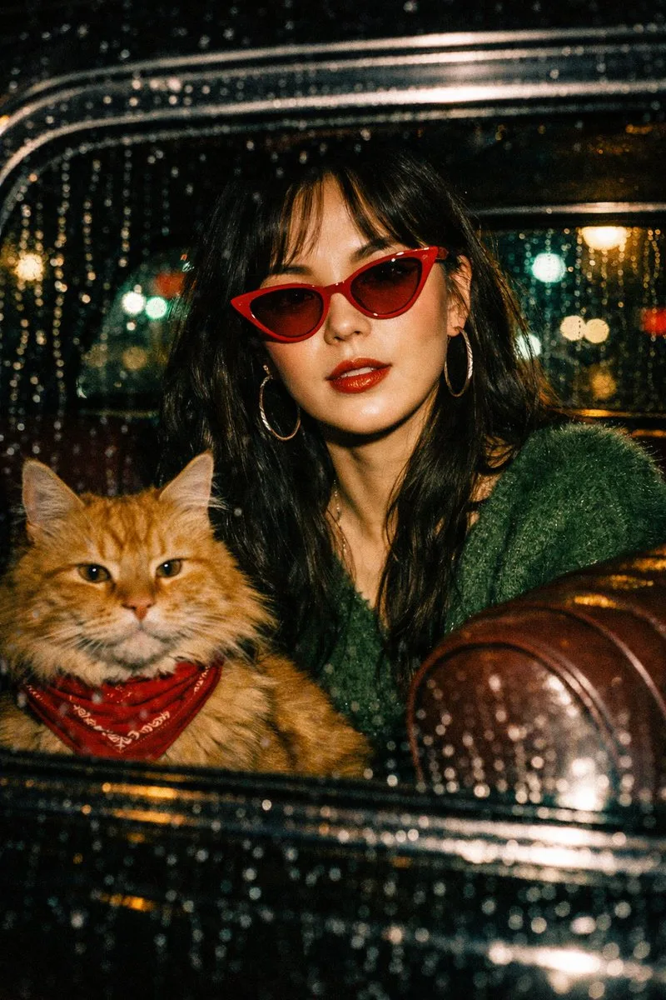

# simeon-sanai — by @Naiknelofar788

[← Back to Examples from X](../../EXAMPLES.md) · Category: Photography · Model: `GPT Image`

<a href="https://x.com/Naiknelofar788/status/2017162200230797327"></a>

Original post: **[@Naiknelofar788 on X](https://x.com/Naiknelofar788/status/2017162200230797327)** · Creator: [simeon-sanai](https://x.com/Naiknelofar788)

## Prompt

```text
A cinematic flash-photography shot viewed through a rain-streaked car window at night. Inside a vintage black car, a chic Asian woman with long dark hair wears bright red cat-eye sunglasses, large hoop earrings, and a fuzzy green sweater. She has glossy red lipstick and is posing coolly. Sitting next to her on the maroon leather seat is a large, fluffy orange tabby cat wearing a red bandana. The background features blurred city streetlights and bokeh in green and teal tones. High-contrast lighting, Wong Kar-wai aesthetic, retro 90s fashion vibe, realistic texture, film grain, 35mm photography.",
  "elements": {
    "subject": {
      "human": "Young Asian woman, trendy, red cat-eye sunglasses, green fuzzy sweater, hoop earrings, glossy red lips",
      "animal": "Fluffy orange tabby cat, Maine Coon mix, red bandana, calm expression"
    },
    "environment": "Inside vintage car, night time, city street, rain on glass, street lights",
    "lighting": "Direct flash, atmospheric street lighting, bokeh background, high contrast shadows",
    "style": "Cinematic, retro 90s, Hong Kong cinema style, film photography, lo-fi aesthetic, candid"
  },
  "negative_prompt": "blurry, low resolution, cartoon, illustration, 3d render, drawing, distorted features, bad anatomy, missing limbs, text, watermark, daylight, bright sun",
  "technical_settings": {
    "aspect_ratio": "9:16",
    "film_stock": "Kodak Portra 800",
    "camera_angle": "Eye-level, shot through glass"
  }
}
```

## Try it

Paste the prompt into **[vinano.ai](https://vinano.ai?utm_source=github&utm_medium=readme&utm_campaign=awesome-image-video-prompts-updating&utm_content=x-page-try)** to generate your own version.

> The image and prompt belong to [@Naiknelofar788](https://x.com/Naiknelofar788) and are shown here with credit for reference. Creators can ask for changes or removal by opening an issue.
