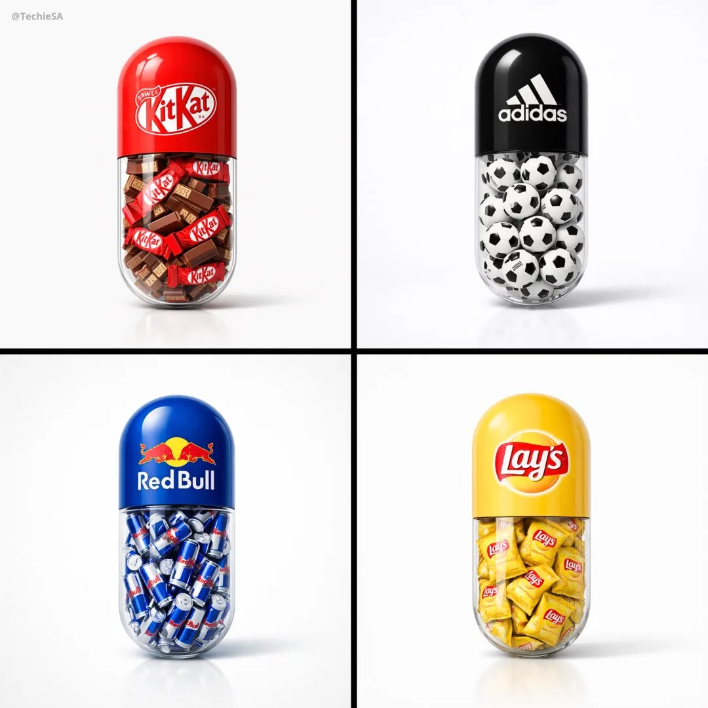

# TechieSA — by @TechieBySA

[← Back to Community Examples](../../EXAMPLES.md) · Category: Illustration & 3D · Model: `GPT Image`

<a href="https://x.com/TechieBySA/status/2038694130650435769"></a>

Source: **[@TechieBySA on X](https://x.com/TechieBySA/status/2038694130650435769)** · Creator: [TechieSA](https://x.com/TechieBySA)

## Prompt

```text
Create a minimal poster. A large capsule pill centered in the frame. The top half of the pill is solid colored and features the [BRAND] logo clearly printed on it. The bottom half of the pill is transparent glass. Inside the transparent part of the capsule, fill it with a large amount of [OBJECT] related to the brand. Ultra clean white studio background, soft shadows, high-end product photography lighting, glossy realistic materials, highly detailed, minimal design, centered composition, modern advertising style.​​​​​​​​​​​​​​​​ 1080x1080 dimension.
```

## Try it

Paste the prompt into **[vinano.ai](https://vinano.ai?utm_source=github&utm_medium=readme&utm_campaign=awesome-image-video-prompts-updating&utm_content=x-page-try)** to generate your own version.

> The image and prompt belong to @TechieBySA ([original post](https://x.com/TechieBySA/status/2038694130650435769)) and are shown here with credit for reference. Creators can ask for changes or removal by opening an issue.
