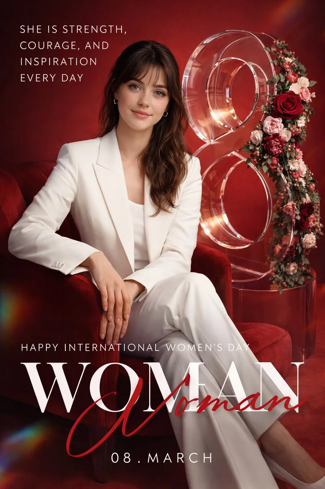

# simeon-sanai — by @Naiknelofar788

[← Back to Examples from X](../../EXAMPLES.md) · Category: Photography · Model: `GPT Image`

<a href="https://x.com/Naiknelofar788/status/2030675663095820332"></a>

Original post: **[@Naiknelofar788 on X](https://x.com/Naiknelofar788/status/2030675663095820332)** · Creator: [simeon-sanai](https://x.com/Naiknelofar788)

## Prompt

```text
Create a high-end promotional poster for International Women's Day, designed as a luxury editorial campaign seamlessly blending photorealistic studio photography with sophisticated modern graphic design.
Identity Matching (Critical): Strictly reference the uploaded image for precise face and identity matching. Preserve the exact facial structure, proportions, skin tone, hairstyle, and natural expression with full fidelity — the subject must remain clearly and unmistakably recognizable throughout.
Composition & Framing: Vertical 4:5 poster format. Three-quarter seated portrait with mid-thigh framing, subject occupying 30–40% of the frame. Subject is positioned slightly left of center, creating intentional visual breathing room on the right for the sculptural element. Editorial balance is paramount.
Subject & Pose: A confident woman with natural wavy hair cascading over one shoulder with soft studio shine. She sits upright yet relaxed in a modern plush red velvet armchair angled slightly toward camera — right leg crossed over left, hands resting softly on her knee, fingers elegant and relaxed. Shoulders are open and confident. Head tilted gently toward camera with a warm, natural smile conveying strength and inspiration. She wears a minimalist tailored white pantsuit — structured blazer, matching trousers, and a clean white blouse beneath — creating bold contrast against the red environment.
Symbolic Element: Behind and slightly right of the subject stands a large transparent acrylic/glass sculpture in the shape of the number "8" (referencing March 8th), nearly matching the subject's seated height. The structure features clean reflective edges with soft studio highlights emphasizing its transparency. Lush floral arrangements cascade organically along its curves — deep red roses, soft pink peonies, delicate light pink blossoms, and natural green leaves — clustered naturally toward the middle and lower sections of the numeral.
Background: Rich monochromatic red studio environment. Wall and floor merge into a seamless smooth red gradient backdrop with a subtle floor reflection anchoring the composition. The red velvet chair blends into the environment while remaining distinct through lighting and fabric texture.
Typography: Elegant, modern poster typography integrated into the layout —
Top left: Clean uppercase white sans-serif text: "SHE IS STRENGTH, / COURAGE, AND / INSPIRATION / EVERY DAY"
Lower section: Small uppercase label: "HAPPY INTERNATIONAL WOMEN'S DAY"
Main headline: Very large bold white block letters spelling "WOMAN" spanning the lower frame, overlaid with a stylized red handwritten script "Woman" crossing diagonally for a dynamic graphic contrast
Bottom center: "08 . MARCH" in wide-tracked minimalist type
Lighting: Professional three-point studio setup — soft frontal key light for flawless skin tones, gentle fill light eliminating harsh shadows, and a subtle rim light sculpting the subject and chair. The glass number 8 catches sharp highlights along its edges.
Visual Effects & Finish: Subtle cinematic prism lens flares and soft rainbow light leaks in the corners and lower foreground for editorial luxury depth. Shallow depth of field keeps the subject and floral sculpture razor sharp while the red background fades into a smooth gradient. Vibrant cinematic color grading, high-end digital compositing polish.
Render Quality: 8K ultra-high resolution. Photorealistic. Luxury advertising aesthetic. No repeated titles or duplicate text elements
```

## Try it

Paste the prompt into **[vinano.ai](https://vinano.ai?utm_source=github&utm_medium=readme&utm_campaign=awesome-image-video-prompts-updating&utm_content=x-page-try)** to generate your own version.

> The image and prompt belong to [@Naiknelofar788](https://x.com/Naiknelofar788) and are shown here with credit for reference. Creators can ask for changes or removal by opening an issue.
