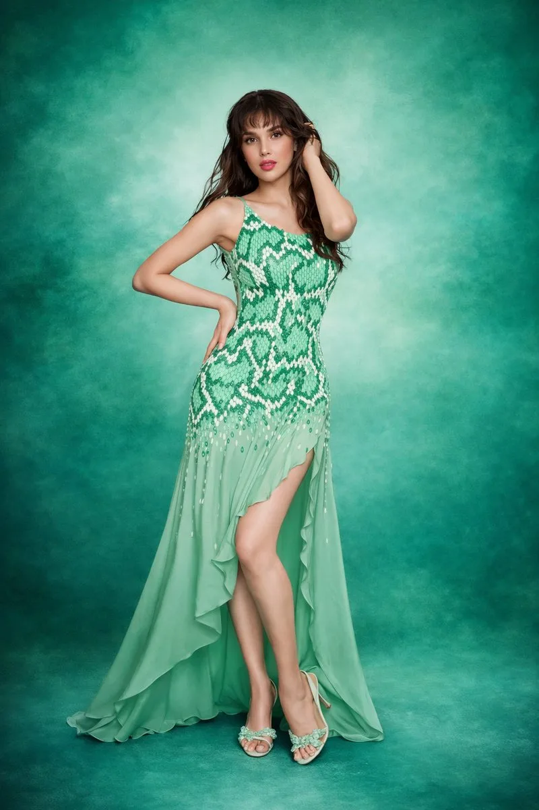

# ShaHid WaNii — by @meng_dagg695

[← Back to Community Examples](../../EXAMPLES.md) · Category: Photography · Model: `GPT Image`

<a href="https://x.com/meng_dagg695/status/2005820511801254047"></a>

Source: **[@meng_dagg695 on X](https://x.com/meng_dagg695/status/2005820511801254047)** · Creator: [ShaHid WaNii](https://x.com/meng_dagg695)

## Prompt

```text
{
  "image_type": "studio fashion portrait",
  "resolution_target": "8K ultra high definition",
  "orientation": "vertical",
  "framing": {
    "shot_type": "full body shot",
    "camera_angle": "straight-on, eye-level",
    "subject_position": "centered",
    "cropping": "head to feet fully visible"
  },
  "subject": {
    "count": 1,
    "gender_presentation": "female-presenting",
    "pose": {
      "body_orientation": "facing forward",
      "weight_distribution": "weight shifted to one leg",
      "legs": {
        "front_leg": "slightly bent at the knee",
        "back_leg": "extended, supporting balance",
        "visibility": "one leg partially exposed through dress slit"
      },
      "arms": {
        "left_arm": "bent with hand resting on hip",
        "right_arm": "raised with hand touching hair near head"
      },
      "posture": "upright, relaxed, confident stance"
    },
    "facial_features": {
      "expression": "neutral to soft confident expression",
      "eyes": "open, looking directly at camera",
      "eyebrows": "well-defined",
      "lips": "full, slightly parted",
      "makeup": {
        "foundation": "smooth, even-toned",
        "blush": "subtle",
        "lip_color": "soft pink",
        "eye_makeup": "defined lashes, neutral tones"
      }
    },
    "hair": {
      "color": "dark brown",
      "length": "long",
      "texture": "slightly wavy",
      "styling": "loose, flowing",
      "bangs": "short fringe across forehead"
    },
    "skin": {
      "tone": "light to medium",
      "texture": "smooth, evenly lit"
    }
  },
  "clothing": {
    "dress": {
      "type": "evening gown",
      "length": "floor length",
      "fit": "fitted bodice, flowing skirt",
      "neckline": "asymmetrical single-strap",
      "strap": {
        "count": 1,
        "placement": "over one shoulder"
      },
      "pattern": "snake-skin inspired geometric pattern",
      "primary_color": "green",
      "secondary_colors": ["white", "light mint green"],
      "fabric": {
        "bodice": "structured, patterned fabric",
        "skirt": "sheer, lightweight, flowing fabric"
      },
      "slit": {
        "presence": true,
        "location": "front side",
        "height": "upper thigh"
      },
      "hemline": "uneven, flowing with layered folds"
    },
    "footwear": {
      "type": "high-heeled sandals",
      "color": "matching green",
      "heel_style": "thin heel",
      "details": "decorative floral or bow-like embellishment on front strap",
      "toe_style": "open-toe"
    },
    "accessories": {
      "visible_jewelry": "none clearly visible",
      "other_accessories": "none visible"
    }
  },
  "background": {
    "type": "studio backdrop",
    "color_palette": ["teal", "green"],
    "texture": "soft, cloudy gradient",
    "pattern": "non-uniform, painterly",
    "depth": "flat backdrop with subtle tonal variation"
  },
  "lighting": {
    "style": "studio lighting",
    "key_light": "soft frontal light",
    "fill_light": "even fill reducing harsh shadows",
    "shadows": "minimal, soft",
    "highlights": "gentle highlights on face and dress texture",
    "overall_exposure": "balanced"
  },
  "color_balance": {
    "dominant_colors": ["green", "teal"],
    "contrast": "moderate",
    "saturation": "medium to slightly high",
    "color_harmony": "monochromatic green tones"
  },
  "image_quality": {
    "sharpness": "high",
    "clarity": "clean and crisp",
    "noise": "none visible",
    "focus": "sharp across entire subject"
  },
  "style_tags": ["fashion photography", "studio portrait", "elegant", "glamour", "high fashion", "editorial"],
  "ai_generation_notes": {
    "do_not_add": ["extra jewelry", "additional subjects", "background objects", "props", "text", "logos"]
  }
}
```

## Try it

Paste the prompt into **[vinano.ai](https://vinano.ai?utm_source=github&utm_medium=readme&utm_campaign=awesome-image-video-prompts-updating&utm_content=x-page-try)** to generate your own version.

> The image and prompt belong to @meng_dagg695 ([original post](https://x.com/meng_dagg695/status/2005820511801254047)) and are shown here with credit for reference. Creators can ask for changes or removal by opening an issue.
