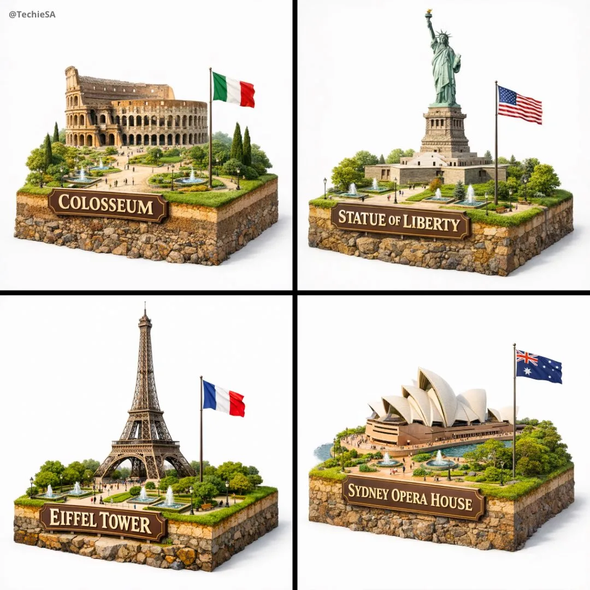

# TechieSA — by @TechieBySA

[← Back to Community Examples](../../EXAMPLES.md) · Category: Illustration & 3D · Model: `GPT Image`

<a href="https://x.com/TechieBySA/status/2007904078274445709"></a>

Source: **[@TechieBySA on X](https://x.com/TechieBySA/status/2007904078274445709)** · Creator: [TechieSA](https://x.com/TechieBySA)

## Prompt

```text
Create a hyper-realistic 3D diorama-style model of [LANDMARK NAME]. The model should appear as a miniature, set on a raised cross-section of earth that reveals soil and rock layers beneath a lush grassy surface. The structure must be highly detailed and proportionally accurate, surrounded by tiny realistic elements like region-appropriate street lamps, native trees, shrubs, water features like small fountains, and historically or culturally fitting pathways. The scene should evoke the unique character of [LANDMARK NAME]’s surrounding landscape. The environment must include a soft white background to draw full attention to the model. Include the text “[LANDMARK NAME]” in large, bold, elegant lettering prominently displayed on a big sign or billboard at the front of the diorama, easily readable and eye-catching, along with a large national flag on a tall, prominent flagpole positioned beside [LANDMARK NAME], clearly visible and waving. 1080x1080 dimension
```

## Try it

Paste the prompt into **[vinano.ai](https://vinano.ai?utm_source=github&utm_medium=readme&utm_campaign=awesome-image-video-prompts-updating&utm_content=x-page-try)** to generate your own version.

> The image and prompt belong to @TechieBySA ([original post](https://x.com/TechieBySA/status/2007904078274445709)) and are shown here with credit for reference. Creators can ask for changes or removal by opening an issue.
