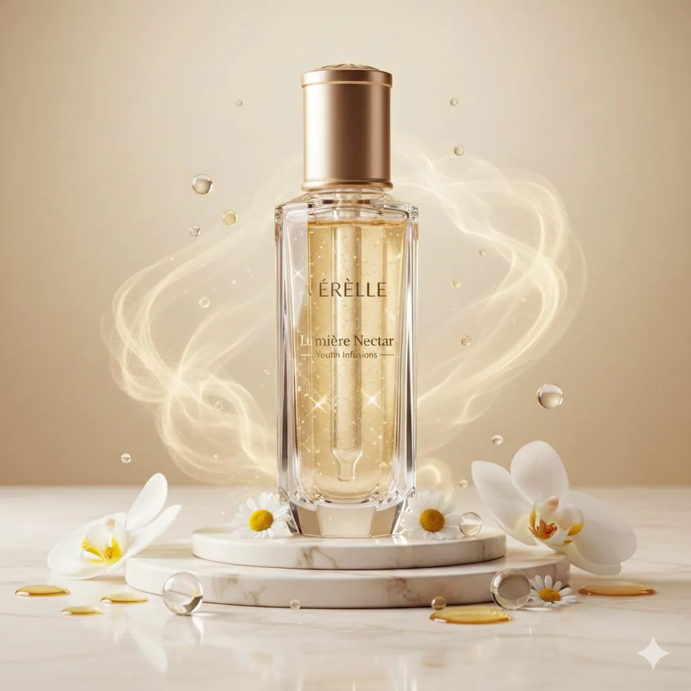

# Meem — by @mehvishs25

[← Back to Community Examples](../../EXAMPLES.md) · Category: Product & Brand · Model: `GPT Image`

<a href="https://x.com/mehvishs25/status/2026285999660397026"></a>

Source: **[@mehvishs25 on X](https://x.com/mehvishs25/status/2026285999660397026)** · Creator: [Meem](https://x.com/mehvishs25)

## Prompt

```text
{
"master_prompt": {
"scene_type": "ultra-realistic luxury skincare commercial photography",

"product": {  
  "type": "premium beauty elixir vial",  
  "brand_name": "VÉRÉLLE",  
  "product_name": "Lumière Nectar — Youth Infusions",  
  "container_shape": "tall faceted crystal vial with elegant vertical geometry",  
  "material": "optical crystal glass",  
  "finish": "prismatic clarity with soft light dispersion",  
  "cap_design": "brushed champagne-gold cap with beveled edge",  

  "label_design": {  
    "style": "Parisian luxury serif typography",  
    "primary_text": "Lumière Nectar",  
    "secondary_text": "Youth Infusions",  
    "finish": "champagne foil emboss with micro-engraved detailing"  
  },  

  "liquid_color": "soft golden nectar with luminous micro-pearl shimmer"  
},  

"composition": {  
  "placement": "center hero placement",  
  "pedestal": "ivory marble pedestal with subtle gold veining",  
  "base_surface": "polished reflective stone surface",  

  "surrounding_elements": [  
    "white orchid petals",  
    "golden honey droplets",  
    "chamomile blossoms",  
    "glass dew spheres"  
  ],  

  "liquid_effect": "soft golden mist swirl behind the vial"  
},  

"lighting": {  
  "style": "high-end beauty studio lighting",  
  "key_light": "soft frontal glow for glass clarity",  
  "rim_light": "warm rim highlights enhancing crystal edges",  
  "fill_light": "luxury soft diffusion",  
  "reflections": "controlled highlights for premium finish"  
},  

"background": {  
  "color": "warm ivory to champagne gradient",  
  "style": "clean editorial luxury backdrop",  
  "depth": "cinematic shallow depth with elegant falloff"  
},  

"camera": {  
  "angle": "slightly low hero angle",  
  "focus": "crystal edges and typography",  
  "depth_of_field": "cinematic shallow depth",  
  "resolution": "8K ultra-detailed clarity"  
},  

"mood_keywords": [  
  "Parisian luxury",  
  "timeless beauty",  
  "radiant skin",  
  "elegant purity",  
  "premium skincare campaign",  
  "refined sophistication"  
]

}
}
```

## Try it

Paste the prompt into **[vinano.ai](https://vinano.ai?utm_source=github&utm_medium=readme&utm_campaign=awesome-image-video-prompts-updating&utm_content=x-page-try)** to generate your own version.

> The image and prompt belong to @mehvishs25 ([original post](https://x.com/mehvishs25/status/2026285999660397026)) and are shown here with credit for reference. Creators can ask for changes or removal by opening an issue.
