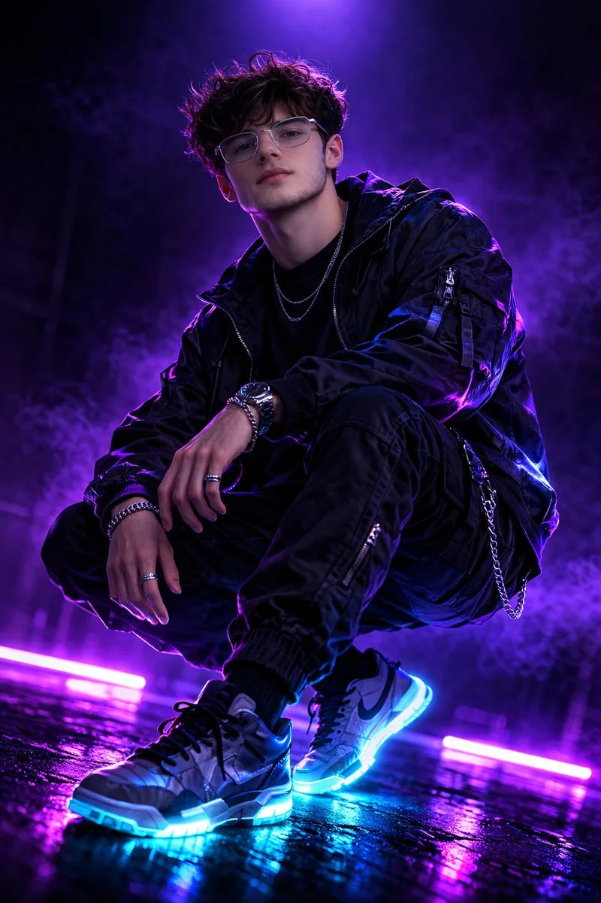

# Harboriis — by @harboriis

[← Back to Examples from X](../../EXAMPLES.md) · Category: Photography · Model: `GPT Image`

<a href="https://x.com/harboriis/status/2026182718435066073"></a>

Original post: **[@harboriis on X](https://x.com/harboriis/status/2026182718435066073)** · Creator: [Harboriis](https://x.com/harboriis)

## Prompt

```text
Fashion photography, professional man model, shot with Canon eos r3, 50mm f/1.2 rf lens, f/2.8 settings, 1/160s, iso 1600, gradient neon violet, streetwear style, holographic effect on wear, luminescent sneaker soles, dark backdrop with deep purple atmospheric lighting, professional studio setup with two led strip lights at floor level and one overhead softbox, cyberpunk aesthetic, side profile active pose with silhouette, dramatic contrast, ultra sharp details, photorealistic quality, rich detailing
```

## Try it

Paste the prompt into **[vinano.ai](https://vinano.ai?utm_source=github&utm_medium=readme&utm_campaign=awesome-image-video-prompts-updating&utm_content=x-page-try)** to generate your own version.

> The image and prompt belong to [@harboriis](https://x.com/harboriis) and are shown here with credit for reference. Creators can ask for changes or removal by opening an issue.
