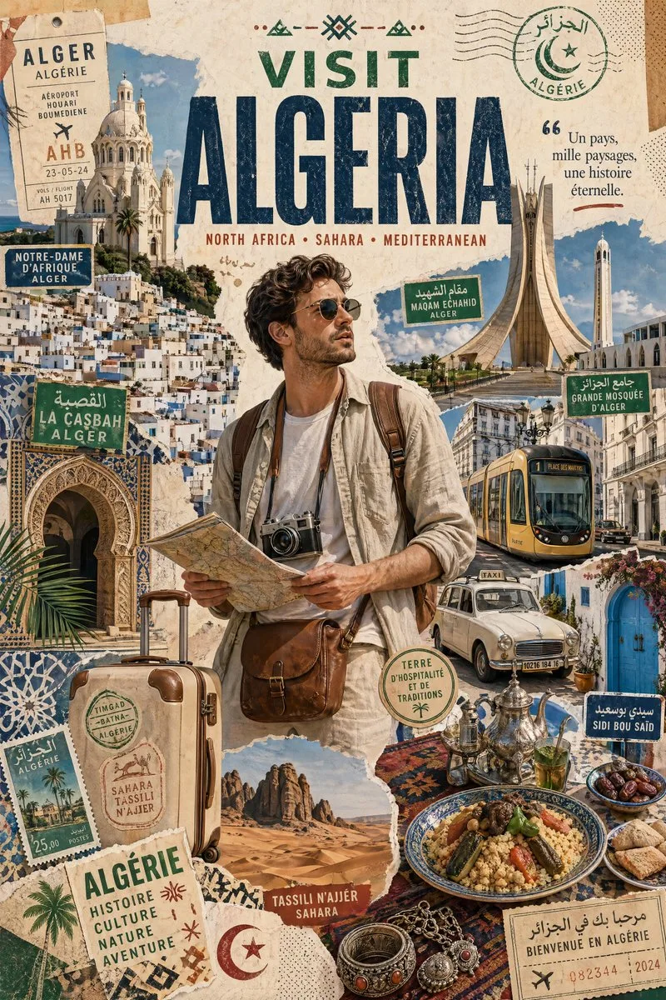

# Ayyoub Ai — by @MaAyyoub

[← Back to Community Examples](../../EXAMPLES.md) · Category: Poster Design · Model: `GPT Image`

<a href="https://x.com/MaAyyoub/status/2048057470812074251"></a>

Source: **[@MaAyyoub on X](https://x.com/MaAyyoub/status/2048057470812074251)** · Creator: [Ayyoub Ai](https://x.com/MaAyyoub)

## Prompt

```text
Create a stylized travel poster / graphic collage for [ALGERIA]. The main subject should be a stylish international tourist visiting [ALGERIA], clearly presented as a traveler and not a local resident. Show the tourist wearing modern travel fashion, with details such as a camera, backpack, sunglasses, map, or suitcase, exploring the culture and atmosphere of [ALGERIA]. Place the tourist in a dynamic composition surrounded by iconic architecture, streets, landscapes, landmarks, transportation, food, signage, and cultural elements associated with [ALGERIA]. Blend realistic character detail with a graphic collage background made of layered paper textures, torn poster edges, sticker elements, halftone dots, editorial typography, and bold geometric shapes. Include authentic visual motifs from [ALGERIA], but keep the tourist’s appearance and styling globally fashionable and clearly foreign to the setting. Add a large readable headline: “VISIT [ALGERIA]”. Modern, artistic, premium editorial travel poster aesthetic, balanced layout, print-worthy composition.
```

## Try it

Paste the prompt into **[vinano.ai](https://vinano.ai?utm_source=github&utm_medium=readme&utm_campaign=awesome-image-video-prompts-updating&utm_content=x-page-try)** to generate your own version.

> The image and prompt belong to @MaAyyoub ([original post](https://x.com/MaAyyoub/status/2048057470812074251)) and are shown here with credit for reference. Creators can ask for changes or removal by opening an issue.
