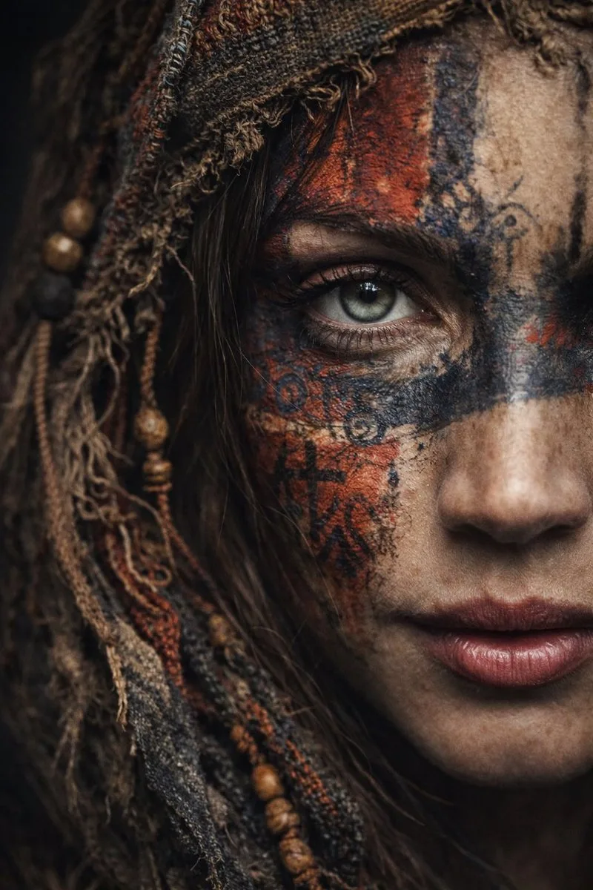

# simeon-sanai — by @Naiknelofar788

[← Back to Examples from X](../../EXAMPLES.md) · Category: Photography · Model: `GPT Image`

<a href="https://x.com/Naiknelofar788/status/2015094660725940712"></a>

Original post: **[@Naiknelofar788 on X](https://x.com/Naiknelofar788/status/2015094660725940712)** · Creator: [simeon-sanai](https://x.com/Naiknelofar788)

## Prompt

```text
A dramatic ultra-realistic portrait of a woman shown in extreme close-up, only half of her face visible. Her skin is painted with bold tribal markings in deep red, navy blue, and muted earth tones, layered with rough textures and symbolic patterns. One striking light-blue eye is sharply in focus, conveying strength, resilience, and quiet intensity. She wears weathered fabric and woven textiles around her head, with frayed edges and smallwooden beads, suggesting ancient or nomadic culture. Cinematic lighting with soft shadows, shallow depth of field, dark neutral background, hyper-detailed skin texture, painterly realism, 8K quality, editorial poster style, moody and powerful atmosphere.
```

## Try it

Paste the prompt into **[vinano.ai](https://vinano.ai?utm_source=github&utm_medium=readme&utm_campaign=awesome-image-video-prompts-updating&utm_content=x-page-try)** to generate your own version.

> The image and prompt belong to [@Naiknelofar788](https://x.com/Naiknelofar788) and are shown here with credit for reference. Creators can ask for changes or removal by opening an issue.
