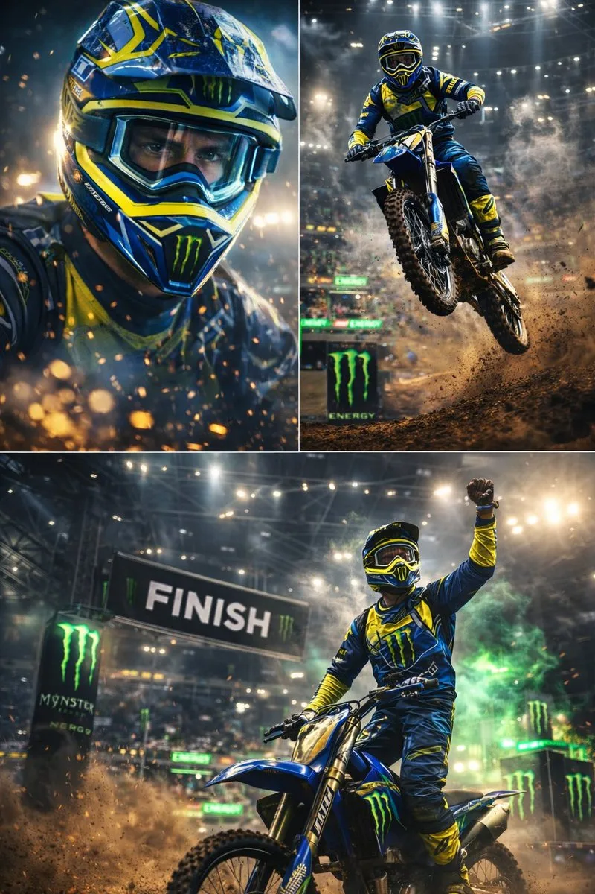

# simeon-sanai — by @Naiknelofar788

[← Back to Community Examples](../../EXAMPLES.md) · Category: Poster Design · Model: `GPT Image`

<a href="https://x.com/Naiknelofar788/status/2023624269385855301"></a>

Source: **[@Naiknelofar788 on X](https://x.com/Naiknelofar788/status/2023624269385855301)** · Creator: [simeon-sanai](https://x.com/Naiknelofar788)

## Prompt

```text
Ultra-dynamic motocross racing scene featuring a professional dirt bike rider performing extreme stunts inside a massive indoor stadium. The composition blends realism and cinematic energy — showing the rider in multiple perspectives: a close-up portrait with a blue and yellow helmet, a mid-action jump on a dirt track, and a victory pose near the finish line. The background features dramatic smoke, spotlights,and structural beams of the stadium, with flashes of neon green accents cutting through the atmosphere. The dirt track is rugged, filled with motion blur, dust particles, and intense lighting contrast. Energy drink branding and banners add authenticity to the motorsport environment. The overall tone is high-octane, gritty, and heroic — perfect for a motorsport poster or promotional artwork.
```

## Try it

Paste the prompt into **[vinano.ai](https://vinano.ai?utm_source=github&utm_medium=readme&utm_campaign=awesome-image-video-prompts-updating&utm_content=x-page-try)** to generate your own version.

> The image and prompt belong to @Naiknelofar788 ([original post](https://x.com/Naiknelofar788/status/2023624269385855301)) and are shown here with credit for reference. Creators can ask for changes or removal by opening an issue.
