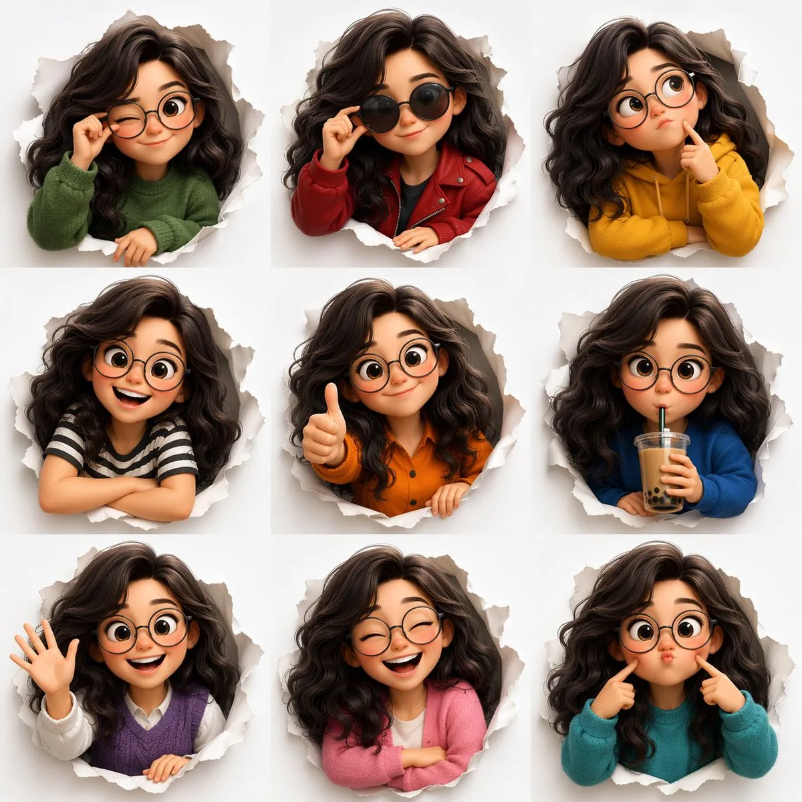

# Austin — by @austinit

[← Back to Examples from X](../../EXAMPLES.md) · Category: Illustration & 3D · Model: `GPT Image`

<a href="https://x.com/austinit/status/2046025895941750868"></a>

Original post: **[@austinit on X](https://x.com/austinit/status/2046025895941750868)** · Creator: [Austin](https://x.com/austinit)

## Prompt

```text
3D Pixar-style expression sheet, cute stylized avatar with wavy dark hair and round glasses, 3x3 grid layout, peeking through torn paper circles, emotions: wink, sunglasses cool, thinking, happy smile, thumbs up, drinking boba tea, friendly wave, laughing, cute pout, different outfits: green sweater, red jacket, yellow hoodie, striped tee, orange shirt, blue top, purple vest, pink cardigan, teal pullover. Soft cinematic lighting, clean white background, vibrant colors, high detail, adorable cartoon character, playful expressions, consistent character design across all poses
```

## Try it

Paste the prompt into **[vinano.ai](https://vinano.ai?utm_source=github&utm_medium=readme&utm_campaign=awesome-image-video-prompts-updating&utm_content=x-page-try)** to generate your own version.

> The image and prompt belong to [@austinit](https://x.com/austinit) and are shown here with credit for reference. Creators can ask for changes or removal by opening an issue.
