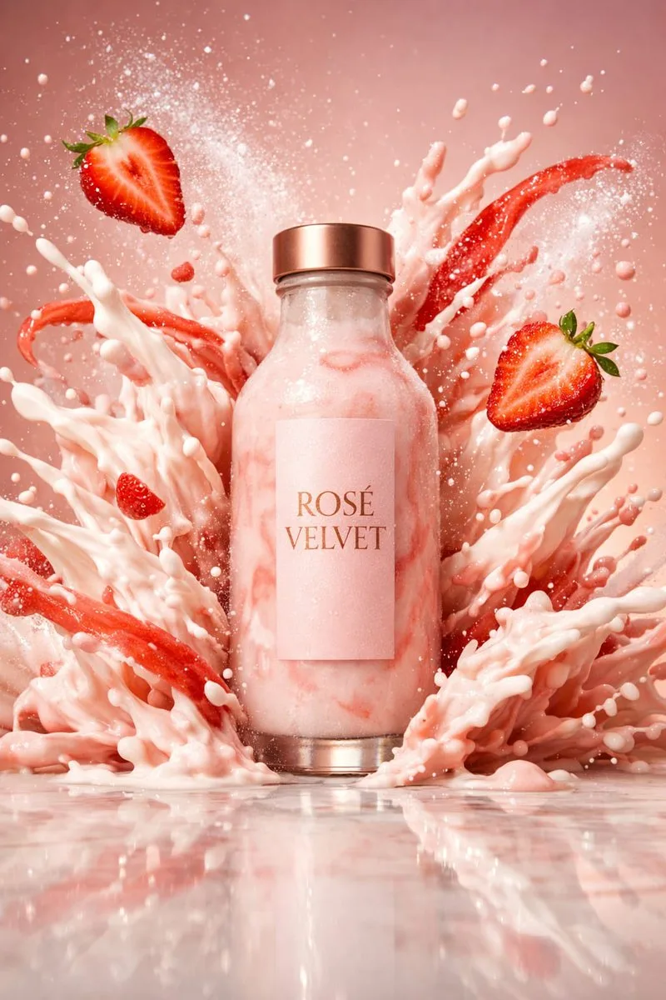

# Meem — by @mehvishs25

[← Back to Examples from X](../../EXAMPLES.md) · Category: Food & Drink · Model: `GPT Image`

<a href="https://x.com/mehvishs25/status/2028279420419752307"></a>

Original post: **[@mehvishs25 on X](https://x.com/mehvishs25/status/2028279420419752307)** · Creator: [Meem](https://x.com/mehvishs25)

## Prompt

```text
{
  "master_prompt": {
    "scene_type": "high-speed commercial luxury shake photography",
    "product": {
      "type": "elegant frosted glass bottle filled with velvety strawberry shake",
      "brand_name": "ROSÉ VELVET",
      "label_design": "minimalist vertical blush label with embossed rose-gold serif typography",
      "liquid_color": "creamy pastel pink with natural strawberry swirls"
    },
    "composition": {
      "action": "dynamic high-velocity creamy splash explosion",
      "surrounding_elements": [
        "sculptural waves of thick strawberry shake splashing outward",
        "silky ribbons of strawberry puree suspended mid-air",
        "floating fresh strawberry halves with visible seeds and juicy texture",
        "soft dusting of powdered sugar diffusing delicately",
        "fine droplets of creamy pink mist catching the light"
      ],
      "placement": "centered hero bottle with a crisp reflection on a polished white marble surface"
    },
    "lighting": {
      "style": "luxury glossy studio product lighting",
      "effects": [
        "sharp rim lighting to define bottle silhouette",
        "brilliant highlights on creamy splashes and glossy strawberry surfaces",
        "soft rosy glow in the background for warmth and elegance"
      ]
    },
    "color_palette": {
      "background": "smooth gradient of blush pink fading into soft champagne ivory",
      "accents": "fresh strawberry red, rose gold, and creamy vanilla tones"
    },
    "technical_specs": {
      "camera": "macro lens, eye-level angle",
      "shutter": "ultra-fast freeze-motion capture",
      "depth_of_field": "shallow focus on the label, gentle blur on dynamic splash elements",
      "quality": "8K resolution, ultra-photorealistic texture"
    }
  }
}
```

## Try it

Paste the prompt into **[vinano.ai](https://vinano.ai?utm_source=github&utm_medium=readme&utm_campaign=awesome-image-video-prompts-updating&utm_content=x-page-try)** to generate your own version.

> The image and prompt belong to [@mehvishs25](https://x.com/mehvishs25) and are shown here with credit for reference. Creators can ask for changes or removal by opening an issue.
