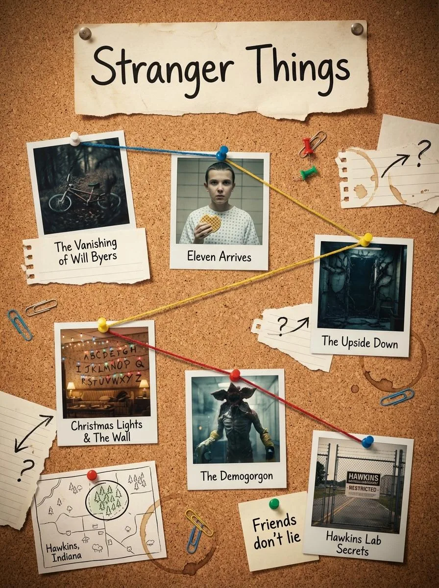

# simeon-sanai — by @Naiknelofar788

[← Back to Community Examples](../../EXAMPLES.md) · Category: Illustration & 3D · Model: `GPT Image`

<a href="https://x.com/Naiknelofar788/status/2029206984353087823"></a>

Source: **[@Naiknelofar788 on X](https://x.com/Naiknelofar788/status/2029206984353087823)** · Creator: [simeon-sanai](https://x.com/Naiknelofar788)

## Prompt

```text
Generates a clean, cinematic 1080×1080 corkboard layout that visually summarizes the story of movie using Polaroid snapshots, handwritten notes, detective-style strings, and vintage textures for "STRANGER THINGS"
```

## Try it

Paste the prompt into **[vinano.ai](https://vinano.ai?utm_source=github&utm_medium=readme&utm_campaign=awesome-image-video-prompts-updating&utm_content=x-page-try)** to generate your own version.

> The image and prompt belong to @Naiknelofar788 ([original post](https://x.com/Naiknelofar788/status/2029206984353087823)) and are shown here with credit for reference. Creators can ask for changes or removal by opening an issue.
