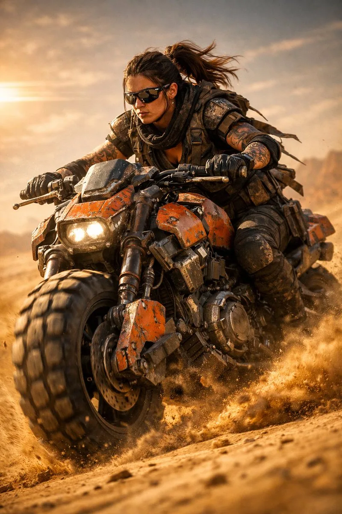

# simeon-sanai — by @Naiknelofar788

[← Back to Examples from X](../../EXAMPLES.md) · Category: Illustration & 3D · Model: `GPT Image`

<a href="https://x.com/Naiknelofar788/status/2016021450575225090"></a>

Original post: **[@Naiknelofar788 on X](https://x.com/Naiknelofar788/status/2016021450575225090)** · Creator: [simeon-sanai](https://x.com/Naiknelofar788)

## Prompt

```text
Use the uploaded picture to create a cinematic sci-fi scene of a fierce futuristic biker riding a heavy armored motorcycle through a vast desert. The person has long hair tied in a messy ponytail, reflective tactical sunglasses, and visible arm tattoos. Wearing a rugged post-apocalyptic outfit with layered fabric, utility straps, and armored details.
The motorcycle is bulky and mechanical, with oversized tires, exposed machinery, and worn orange metal panels covered in dust. Sand blows around the bike as it moves forward, creating a dramatic motion effect. Warm golden sunlight, hazy atmosphere, shallow depth of field, ultra-realistic textures, high detail, cinematic color grading, epic movie poster style 8K resolution, sharp focus, dramatic lighting.
```

## Try it

Paste the prompt into **[vinano.ai](https://vinano.ai?utm_source=github&utm_medium=readme&utm_campaign=awesome-image-video-prompts-updating&utm_content=x-page-try)** to generate your own version.

> The image and prompt belong to [@Naiknelofar788](https://x.com/Naiknelofar788) and are shown here with credit for reference. Creators can ask for changes or removal by opening an issue.
