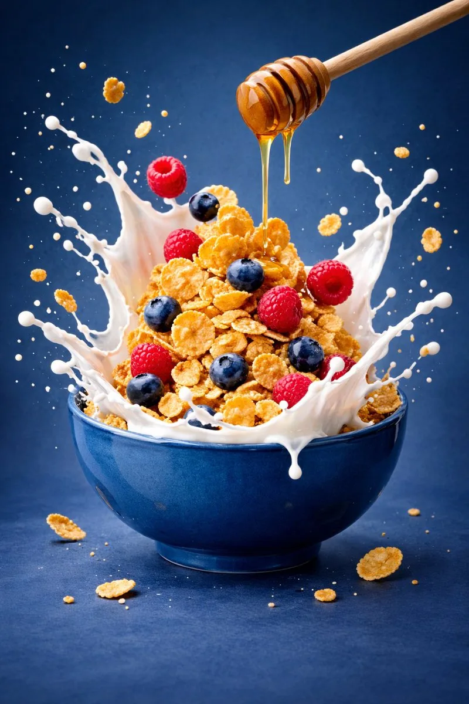

# Meem — by @mehvishs25

[← Back to Community Examples](../../EXAMPLES.md) · Category: Food & Drink · Model: `GPT Image`

<a href="https://x.com/mehvishs25/status/2014162814739611701"></a>

Source: **[@mehvishs25 on X](https://x.com/mehvishs25/status/2014162814739611701)** · Creator: [Meem](https://x.com/mehvishs25)

## Prompt

```text
Ultra-premium cinematic food photography, 8K UHD, 3:4 aspect ratio.
A high-end studio composition featuring a single floating bowl as the hero subject, captured in a high-speed moment with ingredients suspended mid-air. The image conveys controlled energy, freshness, and indulgence.
Lighting is soft, directional, and studio-grade, sculpting textures with clean highlights and natural shadows. Depth of field is shallow-to-medium, isolating the subject while maintaining dimensional realism.
Colors are rich yet natural, with balanced contrast and refined saturation. No artificial glow or exaggerated effects.
The background is a seamless solid or smooth gradient, carefully chosen to complement the ingredients and enhance visual separation.
The bowl is centered, weightless, and dominant. Liquids form elegant arcs and droplets; solid ingredients float naturally with believable physics. Textures are hyper-realistic — creamy bases show organic swirls, crunchy elements appear crisp, herbs look fresh and vibrant.
Shot with a luxury commercial food advertising aesthetic — modern, clean, minimal, bold, and premium.
```

## Try it

Paste the prompt into **[vinano.ai](https://vinano.ai?utm_source=github&utm_medium=readme&utm_campaign=awesome-image-video-prompts-updating&utm_content=x-page-try)** to generate your own version.

> The image and prompt belong to @mehvishs25 ([original post](https://x.com/mehvishs25/status/2014162814739611701)) and are shown here with credit for reference. Creators can ask for changes or removal by opening an issue.
