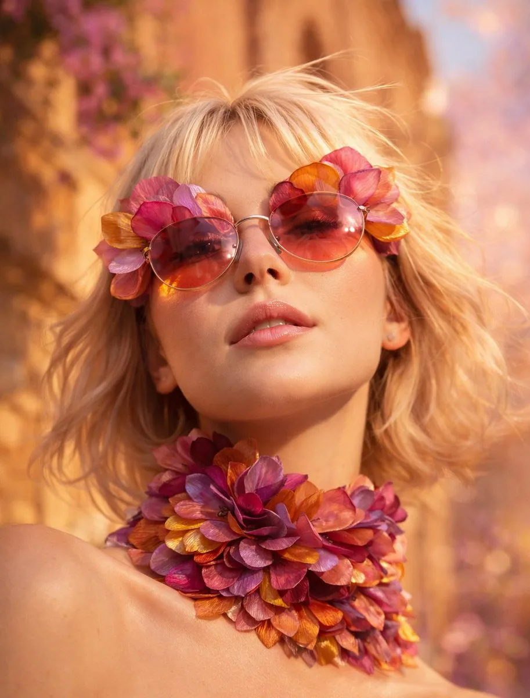

# simeon-sanai — by @Naiknelofar788

[← Back to Examples from X](../../EXAMPLES.md) · Category: Photography · Model: `GPT Image`

<a href="https://x.com/Naiknelofar788/status/2023256749310988332"></a>

Original post: **[@Naiknelofar788 on X](https://x.com/Naiknelofar788/status/2023256749310988332)** · Creator: [simeon-sanai](https://x.com/Naiknelofar788)

## Prompt

```text
Low-angle close-up portrait of a platinum blonde woman wearing oversized sculptural sunglasses crafted from delicate translucent layered flower petals in vibrant magenta, amber, and lilac hues, subtle silk texture visible in each petal with soft golden light passing through the edges, an extravagant couture choker necklace constructed from densely layered matching petals wrapping seamlessly around her entire neck with dimensional depth and organic curvature, her chin slightly lifted with a confident sculpted jawline, subtle freckles dusted across the bridge of her nose, naturally hydrated glossy lips with a soft highlight along the cupid’s bow, fine platinum hair strands gently lifted by a warm breeze with delicate motion at the ends, standing against a softly textured architectural backdrop of warm terracotta walls washed in golden sunset light with cascading lilac bougainvillea and amber-toned stone details, background melting into creamy magenta and lavender bokeh with soft atmospheric glow, rich golden hour sunlight illuminating her face evenly with gentle shadow contouring, warm reflected light from terracotta surfaces enhancing skin luminosity, faint rim light outlining her hair and shoulders, ultra-photorealistic high-fashion editorial photography, cinematic jewel-toned color grading balancing amber highlights with soft lilac shadows and magenta accents, shallow depth of field with elegant telephoto compression, razor-sharp focus on eyelashes and petal contours, shot on Sony A1, 70–200mm lens at 135mm, f/2, ISO 125, 1/1000s, professional editorial sharpness, museum-quality detail, vertical 2:3 composition with eye aligned along upper third

–ar 2:3 –v 6 –s 900 –q 3 –style raw –no text, harsh shadows, lens distortion, oversaturation, artifacts, artificial glow
```

## Try it

Paste the prompt into **[vinano.ai](https://vinano.ai?utm_source=github&utm_medium=readme&utm_campaign=awesome-image-video-prompts-updating&utm_content=x-page-try)** to generate your own version.

> The image and prompt belong to [@Naiknelofar788](https://x.com/Naiknelofar788) and are shown here with credit for reference. Creators can ask for changes or removal by opening an issue.
