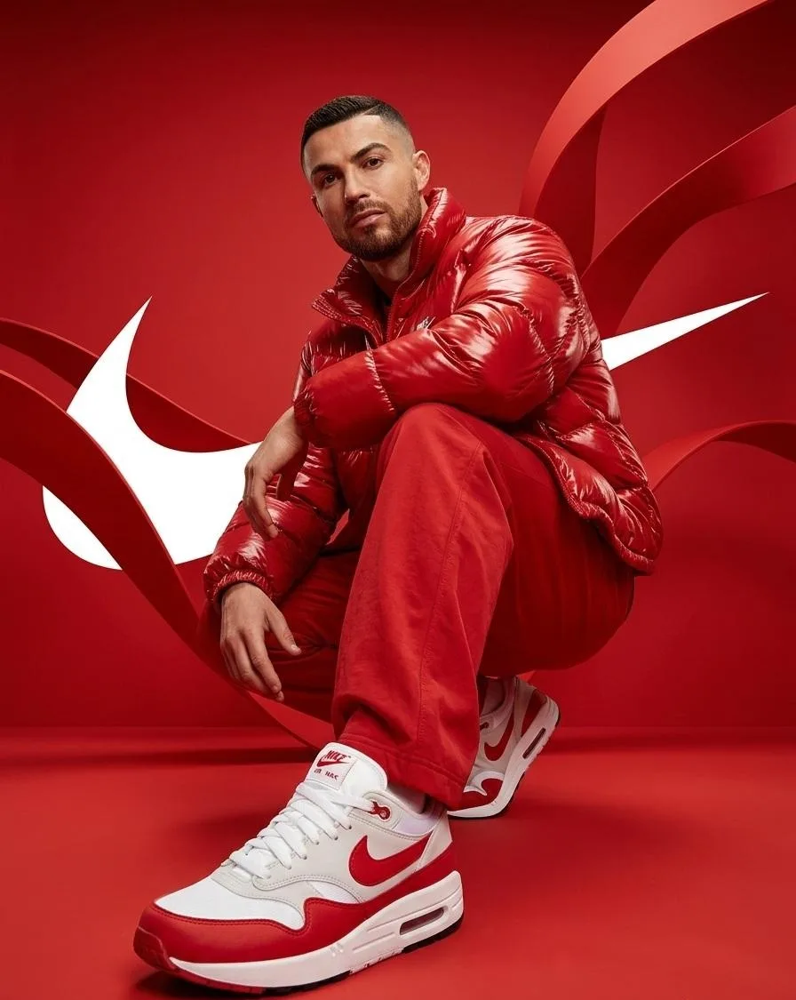

# Saul Goodman — by @Goodmanprotocol

[← Back to Examples from X](../../EXAMPLES.md) · Category: Product & Brand · Model: `GPT Image`

<a href="https://x.com/Goodmanprotocol/status/2038433331944292723"></a>

Original post: **[@Goodmanprotocol on X](https://x.com/Goodmanprotocol/status/2038433331944292723)** · Creator: [Saul Goodman](https://x.com/Goodmanprotocol)

## Prompt

```text
Person from the reference image, with a fade haircut, brown eyes, and a well-groomed short beard, wearing a glossy oversized red puffer jacket and loose red pants with white and red nike sneakers, crouching low with one knee up and one leg forward, left arm resting casually over the raised knee and right hand relaxed near the other leg, body angled slightly to the side while head tilts forward looking directly at the camera with a confident expression, ultra wide-angle low perspective shot emphasizing the front sneaker appearing large and dominant in the foreground, set in a fully red environment with smooth floor and backdrop featuring large white nike swoosh logos behind and flowing ribbon-like red shapes around, hyper-realistic photography, extremely sharp details on fabric shine and sneaker texture, dramatic studio lighting with strong highlights and soft shadows, saturated monochromatic red color palette with white accents, modern streetwear campaign style, no blur, no distortion, no extra limbs, no artifacts
```

## Try it

Paste the prompt into **[vinano.ai](https://vinano.ai?utm_source=github&utm_medium=readme&utm_campaign=awesome-image-video-prompts-updating&utm_content=x-page-try)** to generate your own version.

> The image and prompt belong to [@Goodmanprotocol](https://x.com/Goodmanprotocol) and are shown here with credit for reference. Creators can ask for changes or removal by opening an issue.
