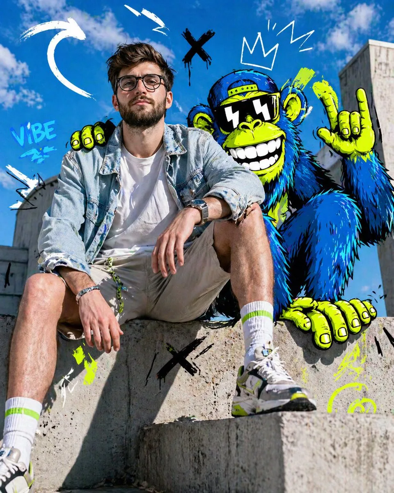

# Duet | AI — by @Sheldon056

[← Back to Examples from X](../../EXAMPLES.md) · Category: Illustration & 3D · Model: `GPT Image`

<a href="https://x.com/Sheldon056/status/2047991391763243032"></a>

Original post: **[@Sheldon056 on X](https://x.com/Sheldon056/status/2047991391763243032)** · Creator: [Duet | AI](https://x.com/Sheldon056)

## Prompt

```text
Full-body fashion editorial shot of a confident young person model sitting casually on a concrete ledge, legs slightly apart, one arm resting on knee, the other relaxed, looking straight at camera with a calm dominant expression.

Wearing a light denim jacket over a plain white t-shirt, neutral shorts, bright socks, and modern sneakers. Clean styling, natural pose, wind slightly moving hair and fabric.

Beside and partially interacting with a stylized cartoon [ANIMAL], positioned naturally as if sharing the same space.

The [ANIMAL] is illustrated in bold cartoon style with thick black outlines, vibrant neon color palette (blue, green, yellow accents), exaggerated proportions, expressive features, playful yet powerful presence.

Background: bright outdoor urban setting with clear blue sky, soft clouds, sunlit concrete textures, strong natural daylight, crisp shadows.

Fusion of hyper-realistic photography and graphic illustration, seamless integration between subject and cartoon.

Add graphic overlay elements: doodle arrows, scribbles, abstract shapes, comic-style symbols, dynamic motion lines.

High contrast, HDR lighting, sharp focus, fashion editorial composition, surreal mixed-media aesthetic, ultra-detailed, 8k resolution.
```

## Try it

Paste the prompt into **[vinano.ai](https://vinano.ai?utm_source=github&utm_medium=readme&utm_campaign=awesome-image-video-prompts-updating&utm_content=x-page-try)** to generate your own version.

> The image and prompt belong to [@Sheldon056](https://x.com/Sheldon056) and are shown here with credit for reference. Creators can ask for changes or removal by opening an issue.
