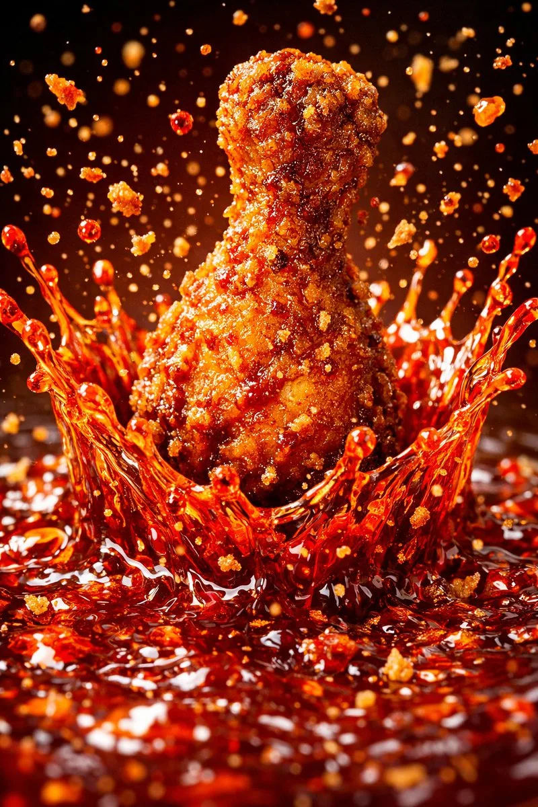

# ShaHid WaNii — by @meng_dagg695

[← Back to Community Examples](../../EXAMPLES.md) · Category: Food & Drink · Model: `GPT Image`

<a href="https://x.com/meng_dagg695/status/2009591285406208118"></a>

Source: **[@meng_dagg695 on X](https://x.com/meng_dagg695/status/2009591285406208118)** · Creator: [ShaHid WaNii](https://x.com/meng_dagg695)

## Prompt

```text
{
  "project": {
    "title": "Hyper-Visual Fried Chicken Action Series",
    "output_quality": "8K Ultra-HD",
    "aspect_ratio": "2:3",
    "style_intent": "High-end commercial food photography",
    "consistency_rule": "Each module shares structure but maintains unique visual dynamics"
  },

  "global_camera_and_rendering": {
    "camera_perspective": "Close-up to extreme macro",
    "focus_behavior": "Crisp subject focus with controlled depth falloff",
    "shutter_effect": "High-speed freeze-frame",
    "texture_priority": "Ultra-detailed crispy breading and crumbs",
    "color_profile": "Warm golden browns, deep reds, high contrast",
    "lighting_quality": "Studio-grade directional lighting with rim highlights",
    "rendering_clarity": "No blur, no softness, no painterly effects"
  },

  "negative_prompt": [
    "motion blur",
    "plastic textures",
    "smooth or waxy food",
    "flat lighting",
    "low detail crumbs",
    "muddy colors",
    "overexposed highlights",
    "cartoon style",
    "unrealistic food physics",
    "oil fog",
    "text artifacts"
  ],

  "modules": {

    "module_1_image_1_style": {
      "scene_type": "Liquid impact action shot",
      "subject": "Single fried chicken drumstick",
      "positioning": "Centered, upright",
      "action": "Drumstick impacting or emerging from liquid splash",
      "liquid_properties": {
        "color": "Deep red-brown",
        "viscosity": "Thick, glossy",
        "behavior": "High splash crown with upward droplets"
      },
      "particle_details": {
        "crumbs": "Small to medium golden crumbs suspended mid-air",
        "distribution": "Surrounding the subject evenly"
      },
      "lighting": {
        "key_light": "Strong frontal light emphasizing texture",
        "rim_light": "Subtle edge highlights on liquid and crust"
      },
      "background": "Dark, nearly black, softly blurred",
      "surface_reflections": "Glossy reflections visible in liquid surface",
      "mood": "Intense, dramatic, high-impact"
    },

    "module_2_image_2_style": {
      "scene_type": "Mid-air food reveal",
      "subject": "Single fried chicken drumstick",
      "action": "Drumstick suspended above an open food box",
      "crumb_motion": "Crumbs falling downward from drumstick",
      "container": {
        "type": "Cardboard food box",
        "color": "White exterior with red interior accents",
        "state": "Open lid, visible interior"
      },
      "lighting": {
        "style": "Soft studio light",
        "effect": "Even illumination with gentle highlights"
      },
      "background": {
        "tone": "Bright, light neutral",
        "depth": "Shallow depth of field, softly blurred"
      },
      "texture_visibility": "Highly defined crunchy coating",
      "mood": "Clean, fresh, appetizing, modern"
    },

    "module_3_image_3_style": {
      "scene_type": "Explosive reveal action shot",
      "subject": "Single fried chicken drumstick",
      "action": "Drumstick bursting upward from food box",
      "explosion_elements": {
        "crumbs": "Large and small fragments radiating outward",
        "direction": "Radial burst from center"
      },
      "lighting": {
        "backlight": "Strong radial backlight creating light rays",
        "contrast": "High contrast between subject and background"
      },
      "container": {
        "type": "Cardboard food box",
        "color": "Red and white",
        "text_visibility": "Visible word 'CHICKEN' on front"
      },
      "background": "Dark with bright light rays emanating behind subject",
      "surface": "Dark tabletop with scattered crumbs",
      "mood": "Energetic, bold, cinematic"
    }
```

## Try it

Paste the prompt into **[vinano.ai](https://vinano.ai?utm_source=github&utm_medium=readme&utm_campaign=awesome-image-video-prompts-updating&utm_content=x-page-try)** to generate your own version.

> The image and prompt belong to @meng_dagg695 ([original post](https://x.com/meng_dagg695/status/2009591285406208118)) and are shown here with credit for reference. Creators can ask for changes or removal by opening an issue.
