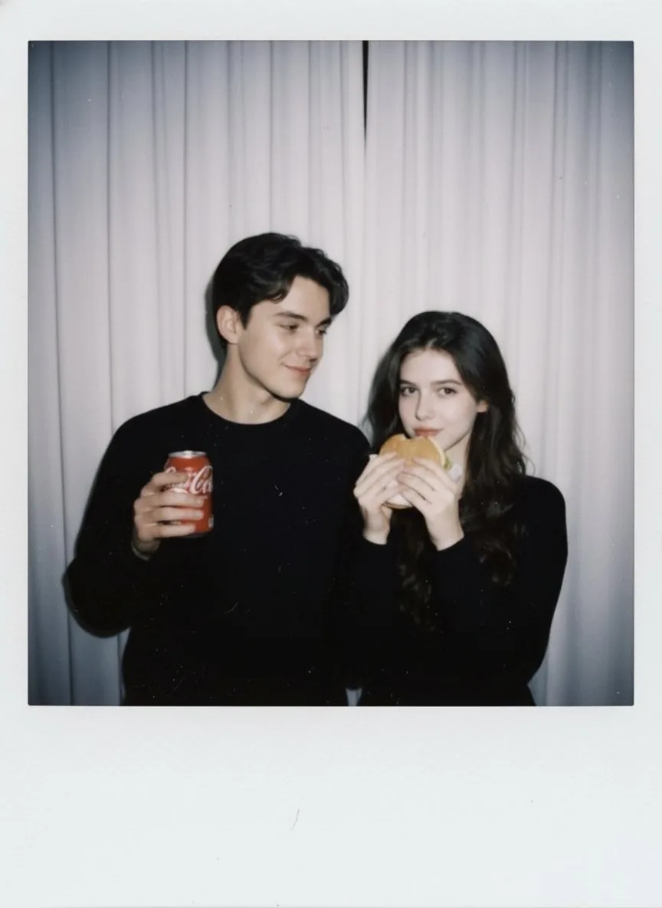

# 𝗦𝗮𝗻𝗶𝗮 — by @saniaspeaks_

[← Back to Community Examples](../../EXAMPLES.md) · Category: Photography · Model: `GPT Image`

<a href="https://x.com/saniaspeaks_/status/2006946255709340062"></a>

Source: **[@saniaspeaks_ on X](https://x.com/saniaspeaks_/status/2006946255709340062)** · Creator: [𝗦𝗮𝗻𝗶𝗮](https://x.com/saniaspeaks_)

## Prompt

```text
{
  "type": "image_generation_prompt",
  "style": "Polaroid-style candid photography",
  "camera_style": {
    "camera": "Polaroid instant camera",
    "look": "ordinary snapshot",
    "effects": [
      "slight blur",
      "soft focus",
      "flash-lit dark room glow",
      "light scattering from on-camera flash",
      "subtle film grain",
      "slight exposure falloff"
    ]
  },
  "identity_preservation": {
    "use_reference_images": true,
    "strict_identity_lock": true,
    "alter_face": false,
    "notes": "Do not change or distort either person’s facial features, expressions, or proportions."
  },
  "subjects": [
    {
      "gender": "female",
      "identity": "user",
      "pose": "cute, casual pose standing close to the boy",
      "prop": "holding a burger",
      "expression": "natural, playful, candid"
    },
    {
      "gender": "male",
      "identity": "boy from reference",
      "pose": "cute, relaxed pose next to the girl",
      "prop": "holding a red Coca-Cola can",
      "expression": "natural, playful, candid"
    }
  ],
  "interaction": {
    "relationship": "friendly and cute",
    "body_language": "standing close together, relaxed, slightly leaning toward each other"
  },
  "environment": {
    "background": "plain white curtains",
    "location": "indoor room",
    "lighting": {
      "type": "single on-camera flash",
      "quality": "consistent, frontal flash lighting",
      "mood": "cozy, intimate, nostalgic"
    }
  },
  "composition": {
    "framing": "medium shot",
    "angle": "eye-level",
    "balance": "centered, casual snapshot composition"
  },
  "aesthetic": {
    "vibe": "cute, nostalgic, intimate",
    "era_feel": "classic instant film look",
    "imperfections": [
      "minor blur",
      "soft edges",
      "natural exposure inconsistencies"
    ]
  },
  "constraints": [
    "No change to faces",
    "No dramatic posing",
    "No artificial glamour or studio look",
    "No text or watermarks",
    "Must look like a real Polaroid photo"
  ],
  "output_goal": "Create a realistic Polaroid-style instant photo of a boy and girl posing cutely together indoors, with white curtains behind them, flash-lit from a dark room, the boy holding a red Coca-Cola can and the girl holding a burger, maintaining an authentic, nostalgic snapshot feel."
}
```

## Try it

Paste the prompt into **[vinano.ai](https://vinano.ai?utm_source=github&utm_medium=readme&utm_campaign=awesome-image-video-prompts-updating&utm_content=x-page-try)** to generate your own version.

> The image and prompt belong to @saniaspeaks_ ([original post](https://x.com/saniaspeaks_/status/2006946255709340062)) and are shown here with credit for reference. Creators can ask for changes or removal by opening an issue.
