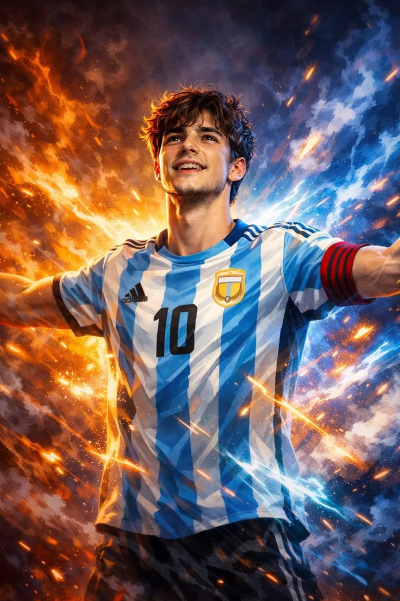

# Harboriis — by @harboriis

[← Back to Community Examples](../../EXAMPLES.md) · Category: Photography · Model: `GPT Image`

<a href="https://x.com/harboriis/status/2020464744197693597"></a>

Source: **[@harboriis on X](https://x.com/harboriis/status/2020464744197693597)** · Creator: [Harboriis](https://x.com/harboriis)

## Prompt

```text
Fantastic digital painting of a young man with high detail, smooth shading, and sharp, bold lines. He stands in a powerful victory pose with his arms outstretched, confident and fearless expression. A brilliantly blended background with swirling smoke and flame like energy effects surrounds him. Neon sparks radiate from his body, creating a vibrant, glowing aura with cinematic lighting and dramatic contrast.
```

## Try it

Paste the prompt into **[vinano.ai](https://vinano.ai?utm_source=github&utm_medium=readme&utm_campaign=awesome-image-video-prompts-updating&utm_content=x-page-try)** to generate your own version.

> The image and prompt belong to @harboriis ([original post](https://x.com/harboriis/status/2020464744197693597)) and are shown here with credit for reference. Creators can ask for changes or removal by opening an issue.
