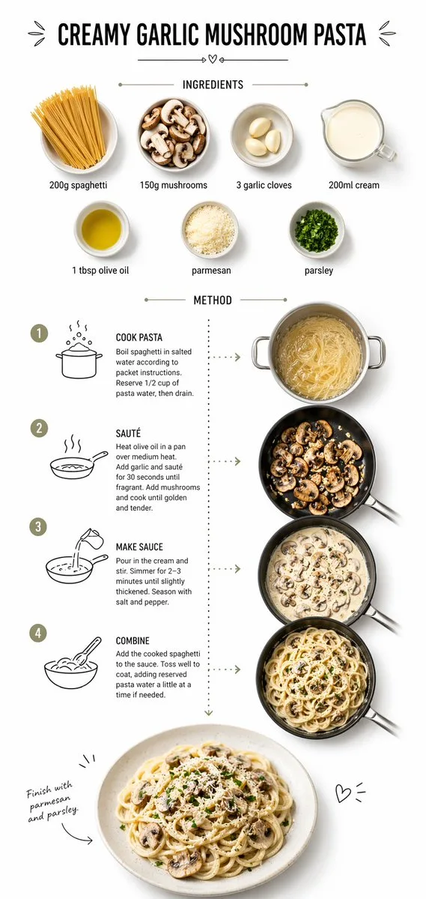

# Ege — by @egeberkina

[← Back to Community Examples](../../EXAMPLES.md) · Category: Food & Drink · Model: `GPT Image`

<a href="https://x.com/egeberkina/status/2046705259267948789"></a>

Source: **[@egeberkina on X](https://x.com/egeberkina/status/2046705259267948789)** · Creator: [Ege](https://x.com/egeberkina)

## Prompt

```text
Create step-by-step recipe infographic for creamy garlic mushroom pasta, top-down view, minimal style on white background, ingredient photos labeled: "200g spaghetti", "150g mushrooms", "3 garlic cloves", "200ml cream", "1 tbsp olive oil", "parmesan", "parsley", dotted lines showing process steps with icons (boiling pot, sauté pan, mixing), final plated pasta shot at the bottom
```

## Try it

Paste the prompt into **[vinano.ai](https://vinano.ai?utm_source=github&utm_medium=readme&utm_campaign=awesome-image-video-prompts-updating&utm_content=x-page-try)** to generate your own version.

> The image and prompt belong to @egeberkina ([original post](https://x.com/egeberkina/status/2046705259267948789)) and are shown here with credit for reference. Creators can ask for changes or removal by opening an issue.
