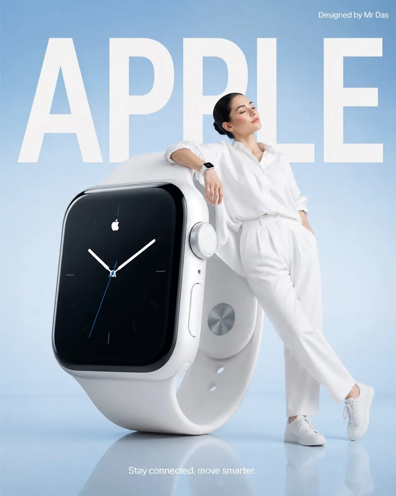

# Mr Das — by @MrDasOnX

[← Back to Community Examples](../../EXAMPLES.md) · Category: Poster Design · Model: `GPT Image`

<a href="https://x.com/MrDasOnX/status/2048643867222962518"></a>

Source: **[@MrDasOnX on X](https://x.com/MrDasOnX/status/2048643867222962518)** · Creator: [Mr Das](https://x.com/MrDasOnX)

## Prompt

```text
Minimalist commercial ad featuring oversized white smartwatch, ultra-clean design. A young woman in all-white outfit leans casually against the giant watch, relaxed confident pose, eyes closed, also wearing the same smartwatch on her wrist. Soft gradient blue background with large bold white “APPLE” text behind. Glossy reflective floor, soft studio lighting, modern high-end fashion/product photography. Small top-right text “Designed by Mr Das”. Bottom center tagline in small white font: “Stay connected, move smarter.”
```

## Try it

Paste the prompt into **[vinano.ai](https://vinano.ai?utm_source=github&utm_medium=readme&utm_campaign=awesome-image-video-prompts-updating&utm_content=x-page-try)** to generate your own version.

> The image and prompt belong to @MrDasOnX ([original post](https://x.com/MrDasOnX/status/2048643867222962518)) and are shown here with credit for reference. Creators can ask for changes or removal by opening an issue.
