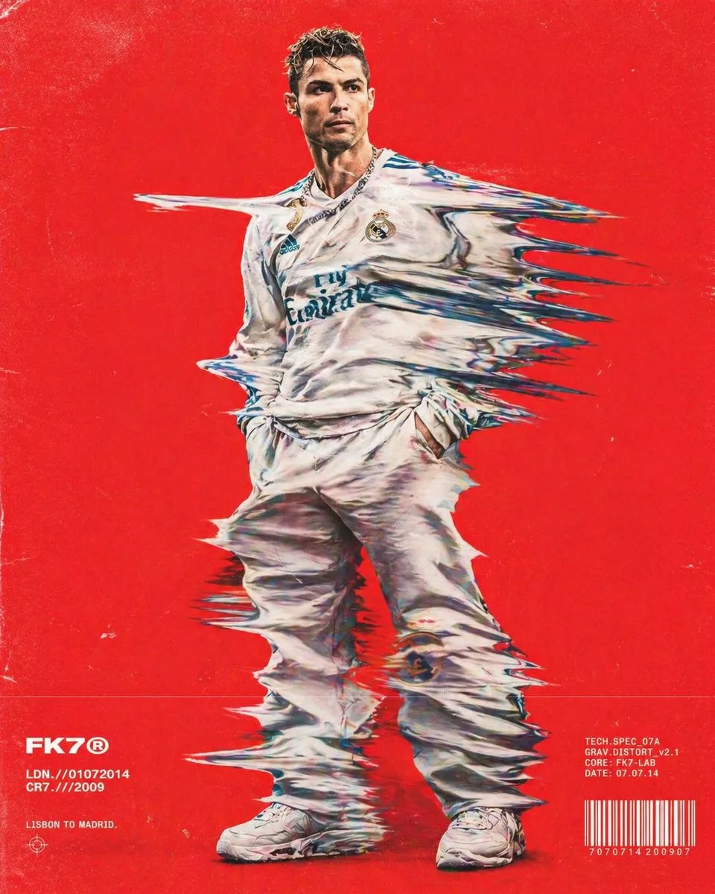

# Saul Goodman — by @Goodmanprotocol

[← Back to Community Examples](../../EXAMPLES.md) · Category: Poster Design · Model: `GPT Image`

<a href="https://x.com/Goodmanprotocol/status/2048599189681291673"></a>

Source: **[@Goodmanprotocol on X](https://x.com/Goodmanprotocol/status/2048599189681291673)** · Creator: [Saul Goodman](https://x.com/Goodmanprotocol)

## Prompt

```text
Hip-hop fashion model standing full-frame, clothing distorted into stretched streaks like motion drag, bold red background, retro film grain, barcode + tiny technical text in bottom area, modern fashion-magazine layout, expressive weirdness, cool attitude , 4K high detail. --ar 4:5 --raw
```

## Try it

Paste the prompt into **[vinano.ai](https://vinano.ai?utm_source=github&utm_medium=readme&utm_campaign=awesome-image-video-prompts-updating&utm_content=x-page-try)** to generate your own version.

> The image and prompt belong to @Goodmanprotocol ([original post](https://x.com/Goodmanprotocol/status/2048599189681291673)) and are shown here with credit for reference. Creators can ask for changes or removal by opening an issue.
