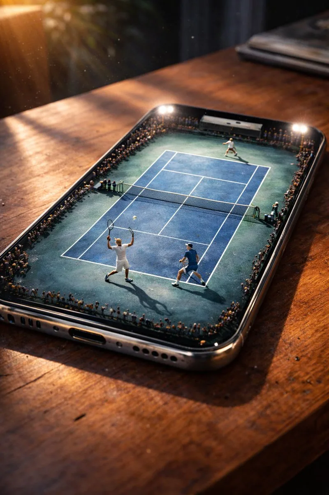

# 𝐌 — by @Strength04_X

[← Back to Community Examples](../../EXAMPLES.md) · Category: Illustration & 3D · Model: `GPT Image`

<a href="https://x.com/Strength04_X/status/2006986719590248769"></a>

Source: **[@Strength04_X on X](https://x.com/Strength04_X/status/2006986719590248769)** · Creator: [𝐌](https://x.com/Strength04_X)

## Prompt

```text
{
  "type": "image_generation",
  "style": "ultra_realistic_cinematic",
  "aspect_ratio": "3:4",
  "resolution": "8K",
  "camera": {
    "model": "DSLR",
    "lens": "50mm",
    "angle": "dynamic slight tilt, courtside perspective",
    "depth_of_field": "shallow",
    "focus": "sharp on phone and players, soft background blur"
  },
  "scene": {
    "subject": "smartphone lying on a wooden table",
    "concept": "phone screen transformed into a professional tennis court",
    "court_surface": "pristine blue hardcourt with fine scratches and chalk marks",
    "players": "miniature tennis players serving, volleying, diving for shots",
    "scale": "realistic miniature proportions"
  },
  "lighting": {
    "type": "dramatic directional lighting",
    "source": "stadium-style lights from the side",
    "effect": "strong highlights and long shadows",
    "reflection": "soft reflection of floodlights on phone glass"
  },
  "details": {
    "phone_surface": [
      "visible fingerprints",
      "subtle smudges",
      "micro scratches on edges"
    ],
    "atmosphere": [
      "floating dust particles",
      "light haze for depth"
    ],
    "textures": "hyper-detailed court surface, realistic materials"
  },
  "environment": {
    "table": "natural wood with grain texture",
    "background": "softly blurred, cinematic indoor setting"
  },
  "color_grading": {
    "palette": "vibrant yet natural",
    "contrast": "high but balanced",
    "tone": "cinematic realism"
  },
  "aesthetic": {
    "mood": "dynamic, energetic, premium sports visual",
    "style": "high-end sports advertisement"
  },
  "render_quality": {
    "sharpness": "ultra-crisp",
    "detail_level": "extreme",
    "photorealism": "DSLR-grade realism"
  }
}
```

## Try it

Paste the prompt into **[vinano.ai](https://vinano.ai?utm_source=github&utm_medium=readme&utm_campaign=awesome-image-video-prompts-updating&utm_content=x-page-try)** to generate your own version.

> The image and prompt belong to @Strength04_X ([original post](https://x.com/Strength04_X/status/2006986719590248769)) and are shown here with credit for reference. Creators can ask for changes or removal by opening an issue.
