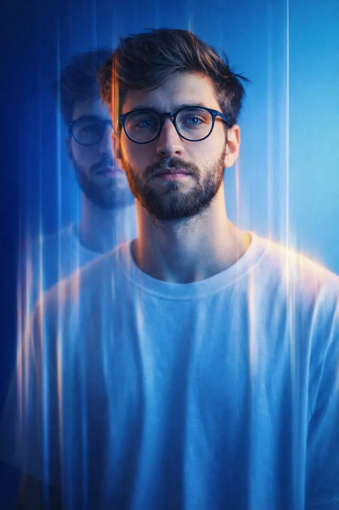

# Duet | AI — by @Sheldon056

[← Back to Community Examples](../../EXAMPLES.md) · Category: Photography · Model: `GPT Image`

<a href="https://x.com/Sheldon056/status/2015623609533026575"></a>

Source: **[@Sheldon056 on X](https://x.com/Sheldon056/status/2015623609533026575)** · Creator: [Duet | AI](https://x.com/Sheldon056)

## Prompt

```text
Create a cinematic, high-fashion half-length portrait of me with a dreamy editorial vibe.
Use multi-exposure blur for ghosting and vertical streaks.
Set against a blue gradient background
(#0033A0 to #66CCFF), the subject wears an oversized white T-shirt.
Apply high-contrast lighting (cool blue wash + orange/yellow edge highlights) for a futuristic glow.
Expression: neutral/introspective, eyes softly lit.
Simulate 50-85mm lens at f/1.8 with shallow dep r field
Enhance with motion blur and chromatic separation, keeping central details sharp.
Aim for a surreal, digital-youth mood blending minimalism and light play.
```

## Try it

Paste the prompt into **[vinano.ai](https://vinano.ai?utm_source=github&utm_medium=readme&utm_campaign=awesome-image-video-prompts-updating&utm_content=x-page-try)** to generate your own version.

> The image and prompt belong to @Sheldon056 ([original post](https://x.com/Sheldon056/status/2015623609533026575)) and are shown here with credit for reference. Creators can ask for changes or removal by opening an issue.
