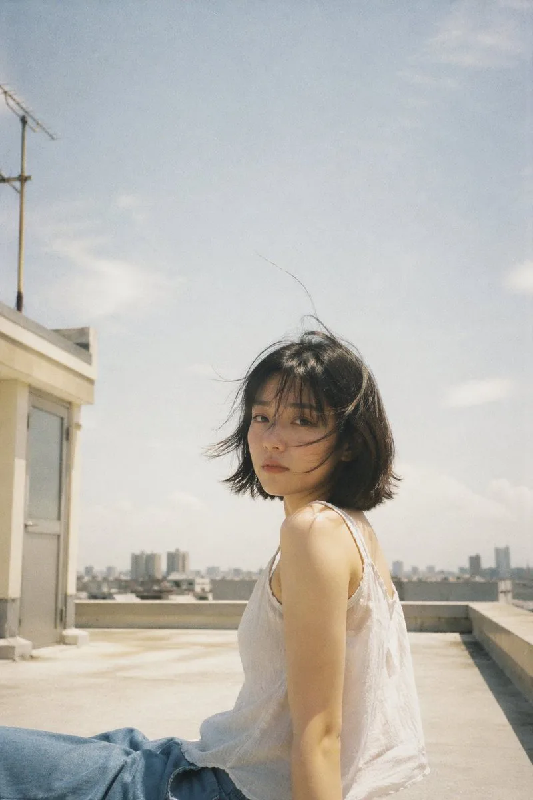

# BubbleBrain — by @BubbleBrain

[← Back to Community Examples](../../EXAMPLES.md) · Category: Photography · Model: `GPT Image`

<a href="https://x.com/BubbleBrain/status/2047631839406297325"></a>

Source: **[@BubbleBrain on X](https://x.com/BubbleBrain/status/2047631839406297325)** · Creator: [BubbleBrain](https://x.com/BubbleBrain)

## Prompt

```text
Japanese negative film aesthetic, rooftop summer scene, soft natural sunlight, slight overexposure highlights, low contrast, muted faded colors, subtle grain  subject standing or sitting on rooftop edge area, body relaxed, slight wind moving hair and clothes, looking toward camera with calm distant gaze, not posing  open sky, empty space, minimal elements, imperfect composition, quiet isolated mood, nostalgic and reflective, “memory-like realism” --2:3
```

## Try it

Paste the prompt into **[vinano.ai](https://vinano.ai?utm_source=github&utm_medium=readme&utm_campaign=awesome-image-video-prompts-updating&utm_content=x-page-try)** to generate your own version.

> The image and prompt belong to @BubbleBrain ([original post](https://x.com/BubbleBrain/status/2047631839406297325)) and are shown here with credit for reference. Creators can ask for changes or removal by opening an issue.
