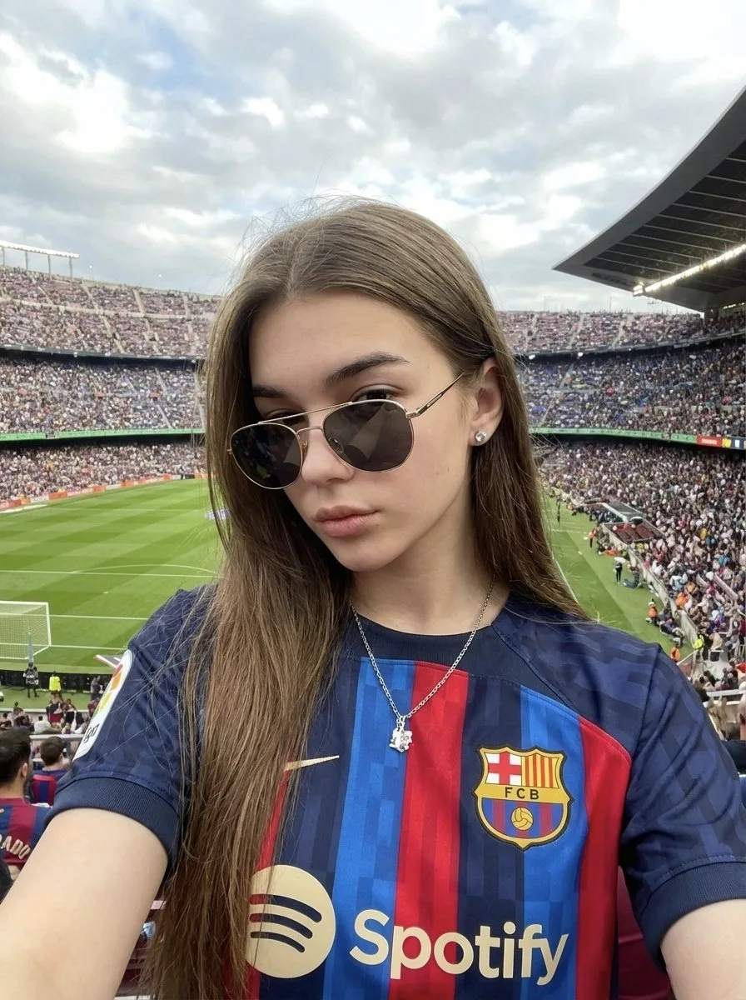

# 𝗦𝗮𝗻𝗶𝗮 — by @saniaspeaks_

[← Back to Examples from X](../../EXAMPLES.md) · Category: Photography · Model: `GPT Image`

<a href="https://x.com/saniaspeaks_/status/2010667809014264132"></a>

Original post: **[@saniaspeaks_ on X](https://x.com/saniaspeaks_/status/2010667809014264132)** · Creator: [𝗦𝗮𝗻𝗶𝗮](https://x.com/saniaspeaks_)

## Prompt

```text
{
  "type": "image_generation_prompt",
  "language": "en",
  "style": "realistic smartphone photography, vibrant sports atmosphere",
  "aspect_ratio": "3:4",
  "identity_preservation": {
    "use_reference_image": true,
    "strict_identity_lock": true,
    "alter_face": false,
    "alter_features": false,
    "notes": "Use the uploaded reference photo. Preserve 100% of the woman’s facial features, proportions, skin texture, hair, and identity."
  },
  "subject": {
    "gender": "female",
    "pose": {
      "type": "selfie-style pose",
      "orientation": "facing the camera",
      "action": "static moment, as if pausing to take a selfie"
    },
    "expression": "serious, confident, and admiring",
    "appearance": {
      "hair": "unchanged from reference image",
      "accessories": [
        "aviator-style sunglasses with gold frame",
        "diamond stud earring in the right ear",
        "silver chain necklace with a pendant"
      ]
    },
    "wardrobe": {
      "top": "official FC Barcelona jersey with Spotify sponsorship"
    }
  },
  "composition": {
    "framing": "centered composition",
    "foreground": "woman occupying the first plane",
    "background": "football stadium and crowd",
    "perspective": "first-person selfie perspective"
  },
  "environment": {
    "location": "packed football stadium",
    "elements": [
      "vibrant green football pitch",
      "crowded stands full of fans",
      "energetic stadium atmosphere"
    ],
    "weather": "cloudy sky",
    "mood": "excitement, celebration, pride"
  },
  "lighting": {
    "type": "natural daylight",
    "conditions": "bright but diffused due to cloudy sky",
    "effects": [
      "vivid colors",
      "balanced exposure",
      "clear facial details"
    ]
  },
  "camera": {
    "device_style": "smartphone rear camera",
    "shot_type": "selfie-style medium close-up",
    "focus": "sharp focus on the subject with slightly softened background",
    "quality": "high sharpness and clarity"
  },
  "quality": {
    "realism": "highly realistic",
    "color": "vibrant and true-to-life",
    "detail_level": "clear textures on clothing, face, and stadium"
  },
  "constraints": [
    "Do not alter facial features",
    "No stylization or artistic filters",
    "No distortion of body or face",
    "No text overlays or watermarks",
    "Maintain realistic proportions and lighting"
  ],
  "output_goal": "Create a realistic, selfie-style photo of a woman wearing a Barcelona jersey in front of a packed football stadium, preserving her exact facial identity and conveying pride and admiration within a vibrant match-day atmosphere."
}
```

## Try it

Paste the prompt into **[vinano.ai](https://vinano.ai?utm_source=github&utm_medium=readme&utm_campaign=awesome-image-video-prompts-updating&utm_content=x-page-try)** to generate your own version.

> The image and prompt belong to [@saniaspeaks_](https://x.com/saniaspeaks_) and are shown here with credit for reference. Creators can ask for changes or removal by opening an issue.
