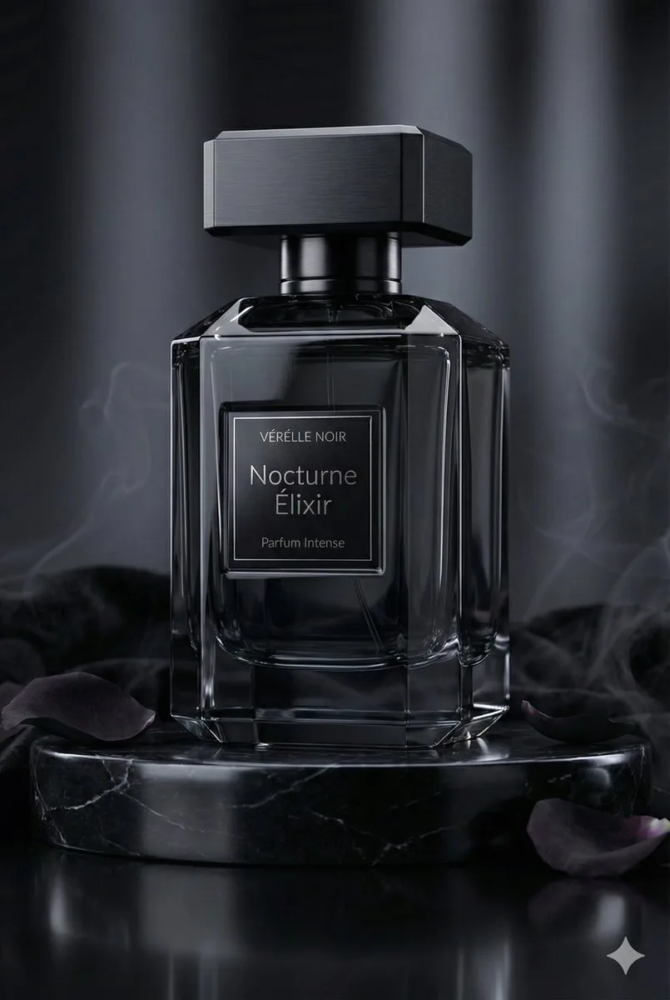

# Jack — by @j_smeaton99

[← Back to Community Examples](../../EXAMPLES.md) · Category: Product & Brand · Model: `GPT Image`

<a href="https://x.com/j_smeaton99/status/2026649286772179445"></a>

Source: **[@j_smeaton99 on X](https://x.com/j_smeaton99/status/2026649286772179445)** · Creator: [Jack](https://x.com/j_smeaton99)

## Prompt

```text
{
  "master_prompt": {
    "scene_type": "ultra-realistic luxury perfume commercial photography",

    "product": {
      "type": "luxury perfume bottle",
      "brand_name": "VÉRÉLLE NOIR",
      "product_name": "Nocturne Élixir — Parfum Intense",
      "container_shape": "faceted architectural silhouette with sharp beveled geometry",
      "material": "obsidian-black crystal glass",
      "finish": "deep glossy translucence with mirror-like reflections",
      "cap_design": "magnetic cap in brushed black titanium with precision-cut edges",

      "label_design": {
        "style": "minimal haute couture typography",
        "primary_text": "Nocturne Élixir",
        "secondary_text": "Parfum Intense",
        "finish": "black chrome foil emboss with micro-engraved detailing"
      },

      "liquid_color": "midnight amber with subtle smoky undertones"
    },

    "composition": {
      "placement": "center hero placement",
      "pedestal": "black marble pedestal with subtle silver veining",
      "base_surface": "high-gloss reflective onyx surface",

      "surrounding_elements": [
        "black velvet fabric folds",
        "dark rose petals",
        "polished obsidian stones",
        "faint aromatic smoke wisps"
      ],

      "atmospheric_effect": "soft drifting fragrance vapor creating a mysterious aura"
    },

    "lighting": {
      "style": "dark luxury cinematic lighting",
      "key_light": "soft focused glow revealing reflective contours",
      "rim_light": "cool silver edge highlights defining silhouette",
      "fill_light": "low ambient fill preserving deep shadows",
      "reflections": "controlled specular highlights for high-end finish"
    },

    "background": {
      "color": "deep charcoal to black gradient",
      "style": "editorial noir luxury backdrop",
      "depth": "cinematic shallow depth with soft shadow falloff"
    },

    "camera": {
      "angle": "low dramatic hero angle",
      "focus": "glass texture and metallic detailing",
      "depth_of_field": "cinematic shallow depth",
      "resolution": "8K ultra-detailed clarity"
    },

    "mood_keywords": [
      "dark elegance",
      "noir luxury",
      "sensual sophistication",
      "mysterious allure",
      "modern opulence",
      "timeless night glamour"
    ]
  }
}
```

## Try it

Paste the prompt into **[vinano.ai](https://vinano.ai?utm_source=github&utm_medium=readme&utm_campaign=awesome-image-video-prompts-updating&utm_content=x-page-try)** to generate your own version.

> The image and prompt belong to @j_smeaton99 ([original post](https://x.com/j_smeaton99/status/2026649286772179445)) and are shown here with credit for reference. Creators can ask for changes or removal by opening an issue.
