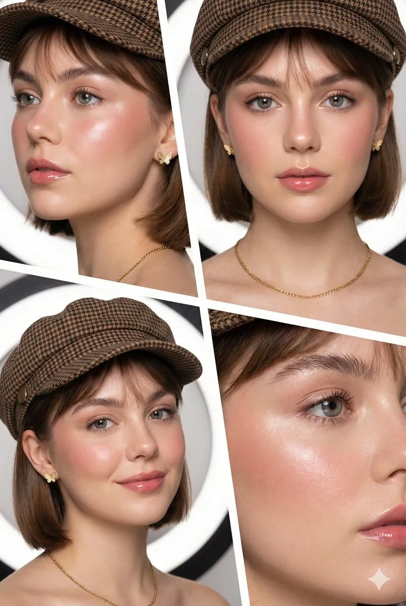

# simeon-sanai — by @Naiknelofar788

[← Back to Community Examples](../../EXAMPLES.md) · Category: Photography · Model: `GPT Image`

<a href="https://x.com/Naiknelofar788/status/2016088856077205937"></a>

Source: **[@Naiknelofar788 on X](https://x.com/Naiknelofar788/status/2016088856077205937)** · Creator: [simeon-sanai](https://x.com/Naiknelofar788)

## Prompt

```text
{
  "prompt_type": "beauty_editorial_collage",
  "layout": {
    "structure": "4-panel split-screen grid",
    "dividers": "Thick white diagonal borders",
    "style": "Modern magazine spread aesthetic"
  },
  "subject": {
    "demographic": "Young woman",
    "aesthetic": "Clean girl / K-beauty influence",
    "features": {
      "skin": "Flawless, dewy, 'glass skin' texture, high luminosity",
      "hair": "Short brown bob cut with wispy bangs, smooth texture",
      "eyes": "Soft grey/hazel contacts"
    }
  },
  "makeup": {
    "style": "No-makeup makeup look",
    "details": [
      "Soft rosy blush high on cheeks",
      "Glossy pink lip tint",
      "Groomed natural fluffy brows",
      "Subtle mascara"
    ]
  },
  "attire_and_accessories": {
    "headwear": "Brown houndstooth pattern newsboy cap (Baker boy hat)",
    "jewelry": "Small delicate gold butterfly stud earrings, thin gold chain necklace"
  },
  "panel_composition": {
    "top_left": "Close-up 3/4 angle, focus on cheek highlight and earring",
    "top_right": "Direct front-facing portrait, symmetrical composition",
    "bottom_left": "Portrait with hat, 3/4 turn, looking at camera",
    "bottom_right": "Extreme close-up side profile, cropping into face"
  },
  "technical_specs": {
    "resolution": "8K",
    "lighting": "Soft commercial studio lighting, ring light reflection in eyes",
    "color_grading": "Desaturated background, warm skin tones, high contrast",
    "style": "High-end beauty photography, hyper-realistic"
  }
}
```

## Try it

Paste the prompt into **[vinano.ai](https://vinano.ai?utm_source=github&utm_medium=readme&utm_campaign=awesome-image-video-prompts-updating&utm_content=x-page-try)** to generate your own version.

> The image and prompt belong to @Naiknelofar788 ([original post](https://x.com/Naiknelofar788/status/2016088856077205937)) and are shown here with credit for reference. Creators can ask for changes or removal by opening an issue.
