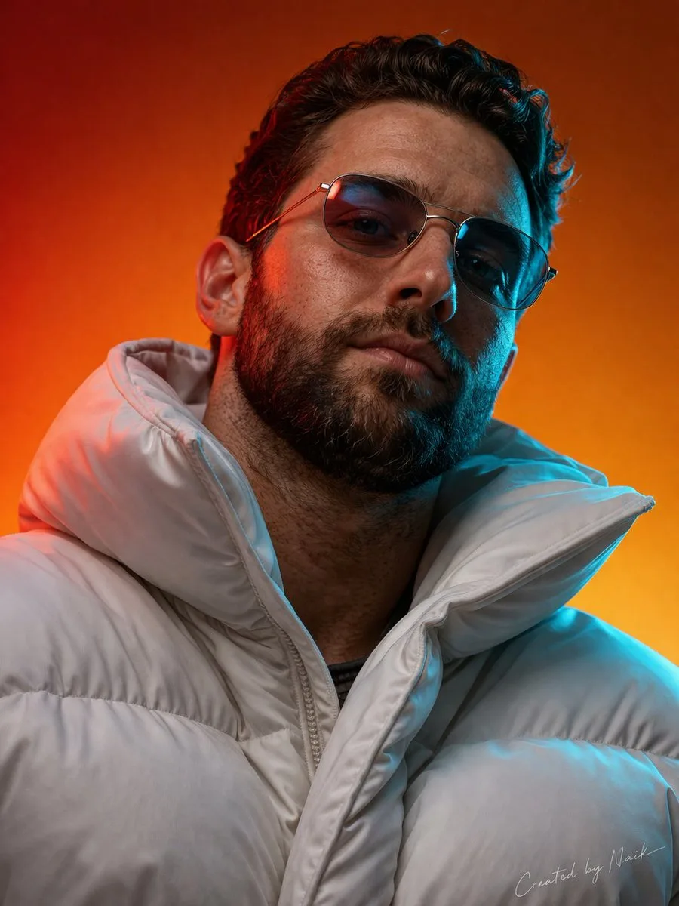

# simeon-sanai — by @Naiknelofar788

[← Back to Community Examples](../../EXAMPLES.md) · Category: Photography · Model: `GPT Image`

<a href="https://x.com/Naiknelofar788/status/2036271660765159675"></a>

Source: **[@Naiknelofar788 on X](https://x.com/Naiknelofar788/status/2036271660765159675)** · Creator: [simeon-sanai](https://x.com/Naiknelofar788)

## Prompt

```text
Create an ultra-photorealistic cinematic portrait of a man viewed from a slightly low angle looking upward with a confident, powerful expression. Generate his face using the uploaded portrait photo. The composition is a tight upper-body portrait with the head tilted slightly upward, emphasizing the jawline and beard structure.
The background is a smooth vibrant studio
gradient transitioning between deep orange and warm red tones, creating a
dramatic modern aesthetic. Use strong cinematic dual-color lighting: warm
red/orange light from one side and cool teal/blue rim lighting from the
opposite side to create striking contrast across the face and beard. The man
is wearing a futuristic white oversized puffer jacket with large quilted sections
and a high protective collar. The jacket should look premium and modern with
realistic fabric folds, padded insulation volume, and subtle material sheen
similar to high-end technical winter fashion. Add extremely detailed textures:
visible skin pores, beard hair strands, subtle facial imperfections, realistic lip
texture, micro skin reflections, and detailed hair follicles. The sunglasses
should have thin metal frames with realistic reflections and slightly tinted
lenses reflecting the colored lighting. The white puffer jacket must show
detailed stitching, fabric grain, padded segments, and realistic light interaction
across the material. Lighting should create soft shadows, strong color
contrast, and dramatic highlights across the face, beard, glasses, and jacket.
Maintain sharp focus on the subject with studio-quality depth and clarity.
Ultra photorealistic portrait photography, cinematic studio lighting, hyper-
detailed textures, 8K detail, premium editorial fashion portrait, extremely
realistic skin and fabric materials.
Add a subtle handwritten text in the bottom-right corner that reads "Created by Naik", elegant fashion-editorial signature style, thin white ink, slightly transparent, like a photographer's signature on a luxury magazine shoot.
```

## Try it

Paste the prompt into **[vinano.ai](https://vinano.ai?utm_source=github&utm_medium=readme&utm_campaign=awesome-image-video-prompts-updating&utm_content=x-page-try)** to generate your own version.

> The image and prompt belong to @Naiknelofar788 ([original post](https://x.com/Naiknelofar788/status/2036271660765159675)) and are shown here with credit for reference. Creators can ask for changes or removal by opening an issue.
