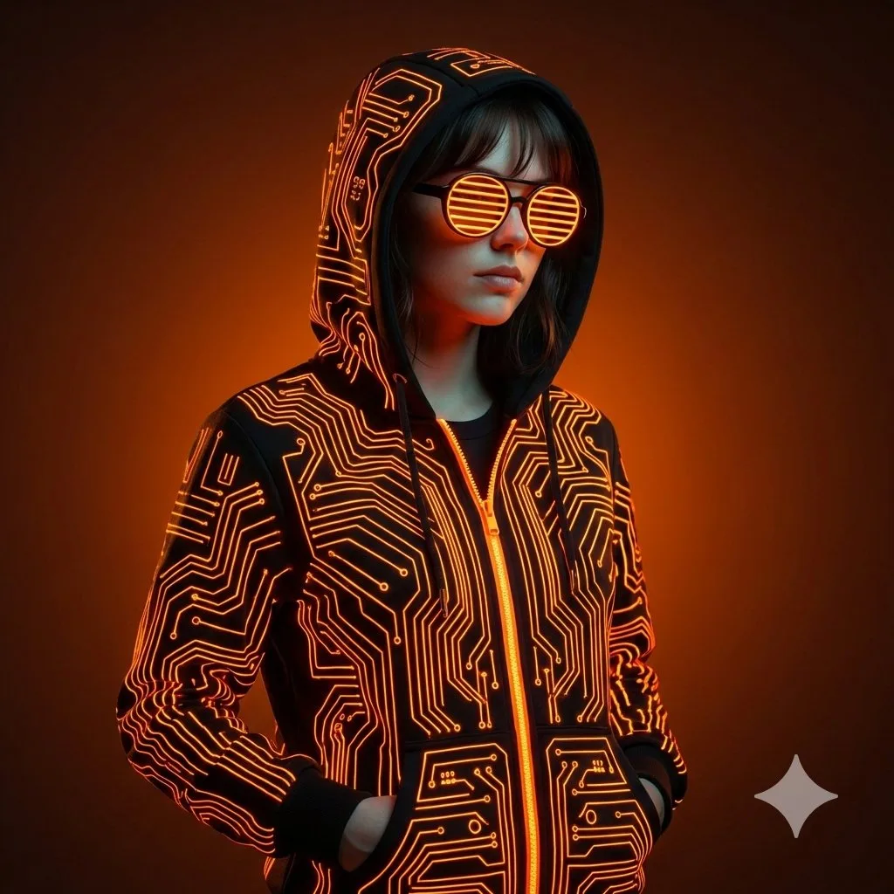

# simeon-sanai — by @Naiknelofar788

[← Back to Community Examples](../../EXAMPLES.md) · Category: Photography · Model: `GPT Image`

<a href="https://x.com/Naiknelofar788/status/2026603084760363062"></a>

Source: **[@Naiknelofar788 on X](https://x.com/Naiknelofar788/status/2026603084760363062)** · Creator: [simeon-sanai](https://x.com/Naiknelofar788)

## Prompt

```text
Ultra-realistic cinematic studio portrait using provided person only. Subject wears black cyberpunk hoodie fully covered in bright glowing neon-orange circuit lines and illuminated zipper, hood up, hands in pockets, three-quarter pose facing right, head slightly down. Round shutter glasses with glowing orange bars. Dramatic studio lighting, glow casting light spill. Smooth dark-to-burnt orange gradient background. Style locked.
```

## Try it

Paste the prompt into **[vinano.ai](https://vinano.ai?utm_source=github&utm_medium=readme&utm_campaign=awesome-image-video-prompts-updating&utm_content=x-page-try)** to generate your own version.

> The image and prompt belong to @Naiknelofar788 ([original post](https://x.com/Naiknelofar788/status/2026603084760363062)) and are shown here with credit for reference. Creators can ask for changes or removal by opening an issue.
