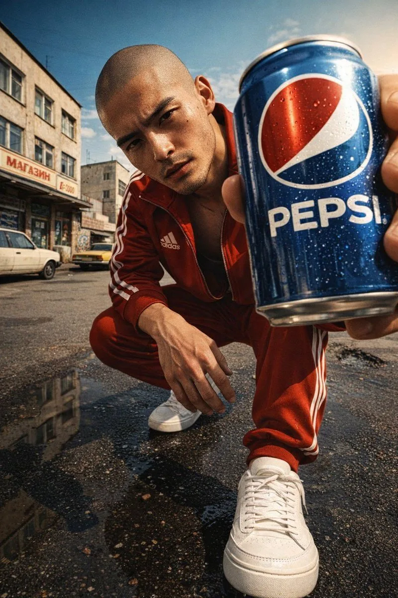

# Harboriis — by @harboriis

[← Back to Examples from X](../../EXAMPLES.md) · Category: Photography · Model: `GPT Image`

<a href="https://x.com/harboriis/status/2029064691482542266"></a>

Original post: **[@harboriis on X](https://x.com/harboriis/status/2029064691482542266)** · Creator: [Harboriis](https://x.com/harboriis)

## Prompt

```text
Ultra-realistic, glossy magazine-style portrait of a young male model, bald, with a stem, rugged expression and defined facial texture (pores, stubble shadows, subtle scars). Camera at shoe level (very low angle), wide-angle perspective, model tilted toward the lens, leaning forward and holding a Pepsi can extremely close to the camera - can label perfectly facing viewer and crisply legible with realistic metal reflections. Wearing a red Adidas tracksuit with visible Adidas logo and clean white sneakers, one foot stepped forward in the foreground. Urban USSR 1990s street environment: weathered concrete, vintage shop signs, old cars, period graffiti, small puddles. Bright sunny daytime with strong direct sunlight casting sharp cinematic shadows, warm sunlight highlights, slight wet reflections on asphalt and subtle water splashes near shoes for dynamism. Shallow depth of field (pin-sharp on face and can, creamy bokeh), ultra high detail, high contrast, vivid colors, warm sunlight with subtle teal-orange grade. Commercial editorial retouching style but preserving skin texture, enhanced clarity on label and metal, realistic specular highlights, natural micro-contrast. Composition: Pepsi can prominent in right foreground, eye-line slightly above center, negative space for masthead/logo--v 7 --style raw --quality 2 --ar 9:16 --chaos 3 --stylize 499-weird 99--exp 50
```

## Try it

Paste the prompt into **[vinano.ai](https://vinano.ai?utm_source=github&utm_medium=readme&utm_campaign=awesome-image-video-prompts-updating&utm_content=x-page-try)** to generate your own version.

> The image and prompt belong to [@harboriis](https://x.com/harboriis) and are shown here with credit for reference. Creators can ask for changes or removal by opening an issue.
