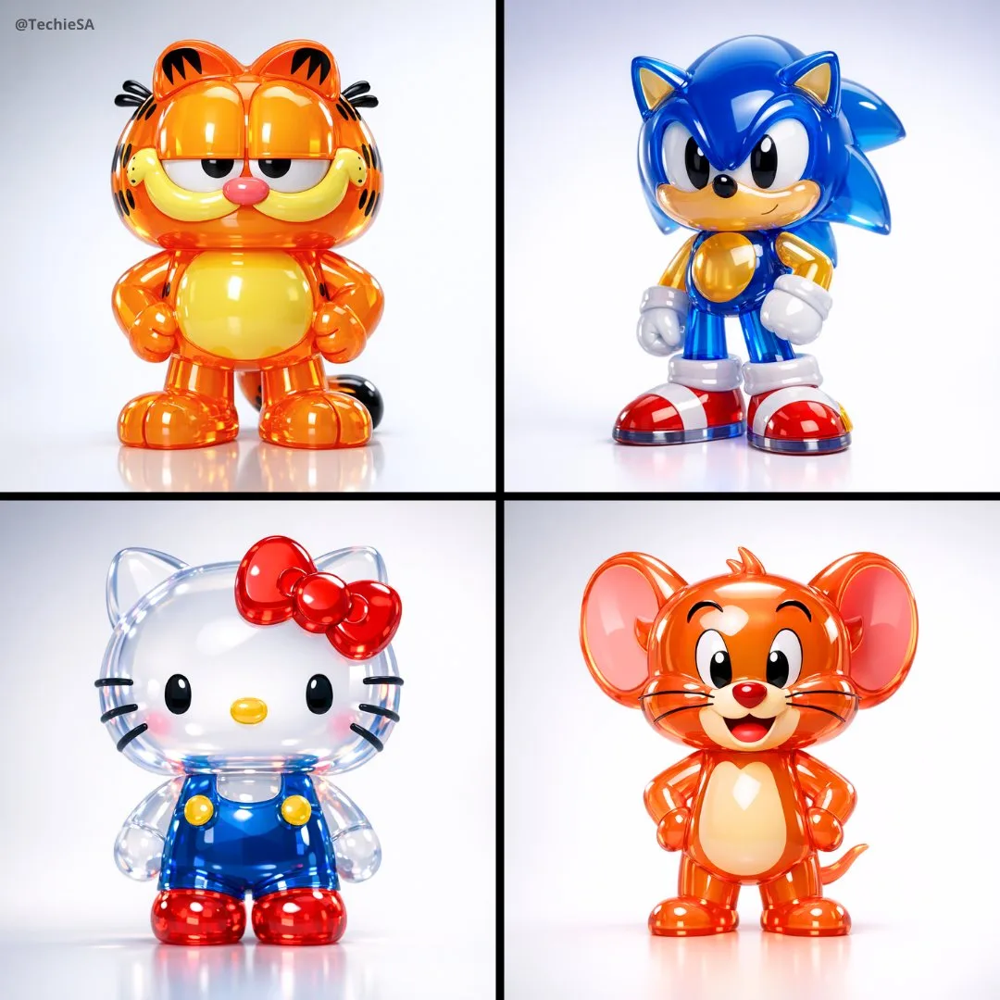

# TechieSA — by @TechieBySA

[← Back to Examples from X](../../EXAMPLES.md) · Category: Illustration & 3D · Model: `GPT Image`

<a href="https://x.com/TechieBySA/status/2009229875794858182"></a>

Original post: **[@TechieBySA on X](https://x.com/TechieBySA/status/2009229875794858182)** · Creator: [TechieSA](https://x.com/TechieBySA)

## Prompt

```text
Create a premium 3D rendered [FIGURE NAME] collectible vinyl figure in a modern designer toy aesthetic. The figure should feature glossy translucent vinyl material with subtle light refraction, bold saturated colors true to the character, and simplified geometric forms with smooth curves. Position against a pristine gradient background transitioning from light gray to white. Use professional product photography lighting with soft key light from above and gentle rim lighting to highlight the vinyl’s glossy finish. The character should be posed in a confident standing position, centered perfectly in frame. Apply shallow depth of field with the figure in sharp focus. Render in ultra-high resolution with clean minimalist composition, no text, logos, or distracting elements. Square aspect ratio 1080x1080 pixels, photorealistic quality with crisp details and vibrant color reproduction suitable for premium toy marketing
```

## Try it

Paste the prompt into **[vinano.ai](https://vinano.ai?utm_source=github&utm_medium=readme&utm_campaign=awesome-image-video-prompts-updating&utm_content=x-page-try)** to generate your own version.

> The image and prompt belong to [@TechieBySA](https://x.com/TechieBySA) and are shown here with credit for reference. Creators can ask for changes or removal by opening an issue.
