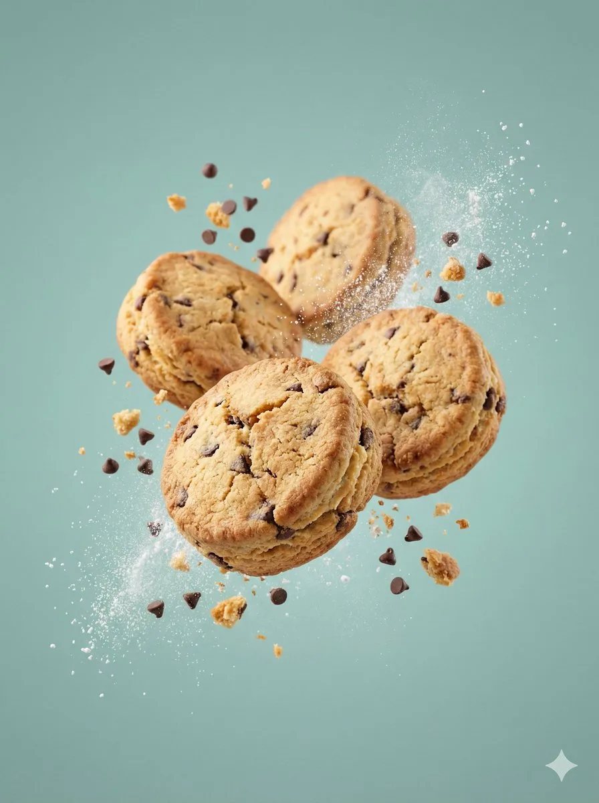

# Johnn — by @john_my07

[← Back to Community Examples](../../EXAMPLES.md) · Category: Food & Drink · Model: `GPT Image`

<a href="https://x.com/john_my07/status/2019796977299681757"></a>

Source: **[@john_my07 on X](https://x.com/john_my07/status/2019796977299681757)** · Creator: [Johnn](https://x.com/john_my07)

## Prompt

```text
{
  "global_settings": {
    "resolution": "8K ultra-high-definition",
    "aspect_ratio": "3:4 vertical",
    "render_style": "photorealistic high-end biscuit photography",
    "quality": "luxury advertising standard",
    "clarity": "ultra-sharp with visible fine textures",
    "grain": "zero",
    "visual_artifacts": "none",
    "depth_of_field": "selective focus with soft background falloff",
    "motion_capture": "ingredients suspended in mid-air",
    "background_style": "clean monochrome studio backdrop"
  },

  "subject": {
    "main_food": "assorted biscuit-style cookies",
    "quantity": 4,
    "appearance": [
      "uniform baked biscuits with refined edges",
      "lightly toasted surface with subtle cracks",
      "visible chocolate bits and butter layers",
      "dry-crisp texture typical of premium biscuits",
      "precise handcrafted finish"
    ],
    "branding_rules": [
      "no typography",
      "no logos",
      "no imprints",
      "no decorative marks",
      "no symbols"
    ]
  },

  "secondary_elements": {
    "ingredients_floating": [
      "mini chocolate chips",
      "biscuit crumbs",
      "powdered sugar dust"
    ],
    "motion_style": "controlled burst with natural spread",
    "distribution": "organic scatter surrounding the biscuits",
    "particle_detail": "high-speed frozen motion with layered depth"
  },

  "composition": {
    "camera_angle": "slightly elevated three-quarter angle",
    "framing": "central hero focus with visual breathing space",
    "spacing": "ample negative space for premium feel",
    "focus_priority": "foreground biscuit in extreme sharp focus"
  },

  "lighting": {
    "type": "studio-grade cinematic lighting",
    "key_light": "soft diffused directional light",
    "fill_light": "low-intensity fill to reveal surface detail",
    "rim_light": "delicate edge glow for separation",
    "shadows": "smooth and realistic with gentle falloff"
  },

  "color_palette": {
    "background_color": "muted pastel teal",
    "biscuit_tones": "light golden beige and toasted browns",
    "accent_colors": "deep cocoa browns, soft sugar whites",
    "contrast": "strong subject isolation from background"
  },

  "photography_style": {
    "genre": "premium biscuit advertising",
    "mood": "clean, refined, indulgent",
    "cleanliness": "immaculate studio finish",
    "post_processing": "subtle professional retouching, natural tones"
  },

  "exclusions": [
    "text",
    "branding",
    "watermarks",
    "hands",
    "serving ware",
    "props",
    "wrappers",
    "environmental elements",
    "illustration",
    "cartoon rendering"
  ]
}
```

## Try it

Paste the prompt into **[vinano.ai](https://vinano.ai?utm_source=github&utm_medium=readme&utm_campaign=awesome-image-video-prompts-updating&utm_content=x-page-try)** to generate your own version.

> The image and prompt belong to @john_my07 ([original post](https://x.com/john_my07/status/2019796977299681757)) and are shown here with credit for reference. Creators can ask for changes or removal by opening an issue.
