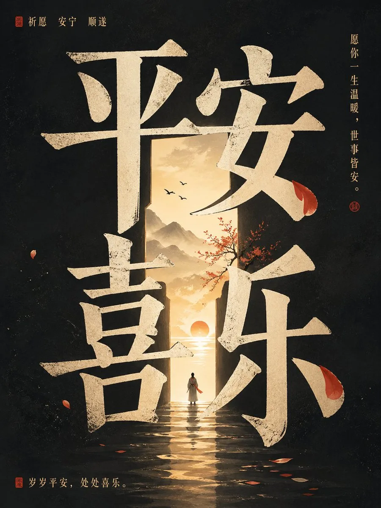

# 小互 — by @xiaohu

[← Back to Community Examples](../../EXAMPLES.md) · Category: Poster Design · Model: `GPT Image`

<a href="https://x.com/xiaohu/status/2048630851051892985"></a>

Source: **[@xiaohu on X](https://x.com/xiaohu/status/2048630851051892985)** · Creator: [小互](https://x.com/xiaohu)

## Prompt

```text
高级概念海报，竖版 3:4，核心文字为[输入文字]

请先深度理解'[输入文字]'的表层含义、深层寓意、情绪气质、文化联想、人物命运感与隐含张力，再决定最适合它的画面风格、构图方式、色彩气质和视觉隐喻。

画面风格必须由词义自动生成，不要机械套用统一模板。每个词都应拥有和它自身内涵相匹配的独特视觉语言。

画面中，巨大中文主标题“[输入文字]”必须是绝对主体，字形清晰完整，无错字无缺笔，占据大部分画面，形成最强第一视觉。
不要做普通插画，不要只画人物外貌。

请提炼一个最准确、最有代表性的视觉隐喻，让人物、物体、空间或象征元素与大字发生关系，让观者一眼感受到这个词为什么会被这样表达。
整体气质要求高级、极简、克制、展览级，具有强排版、强隐喻、强情绪、强记忆点。

可根据词义自动选择更冷峻、更诗意、更悲剧、更锋利、更温柔或更庄严的视觉风格。

色彩也应根据词义自动调整，但保持整体高级感和节制感。

小字文案只保留三处：

左上角：2到4个关键词
右侧竖排：一句命运感短句
左下角：一句有传播力的总结句
要求元素少，概念准，留白克制。

文字是第一视觉，隐喻图像是第二视觉，小字是第三视觉。

不要拥挤，不要廉价广告感，不要多余英文，不要解释性长文案。

最终效果应像展览级文学人物或概念主题海报，把“【输入文字】”背后的精神状态和文化意味真正视觉化。
```

## Try it

Paste the prompt into **[vinano.ai](https://vinano.ai?utm_source=github&utm_medium=readme&utm_campaign=awesome-image-video-prompts-updating&utm_content=x-page-try)** to generate your own version.

> The image and prompt belong to @xiaohu ([original post](https://x.com/xiaohu/status/2048630851051892985)) and are shown here with credit for reference. Creators can ask for changes or removal by opening an issue.
