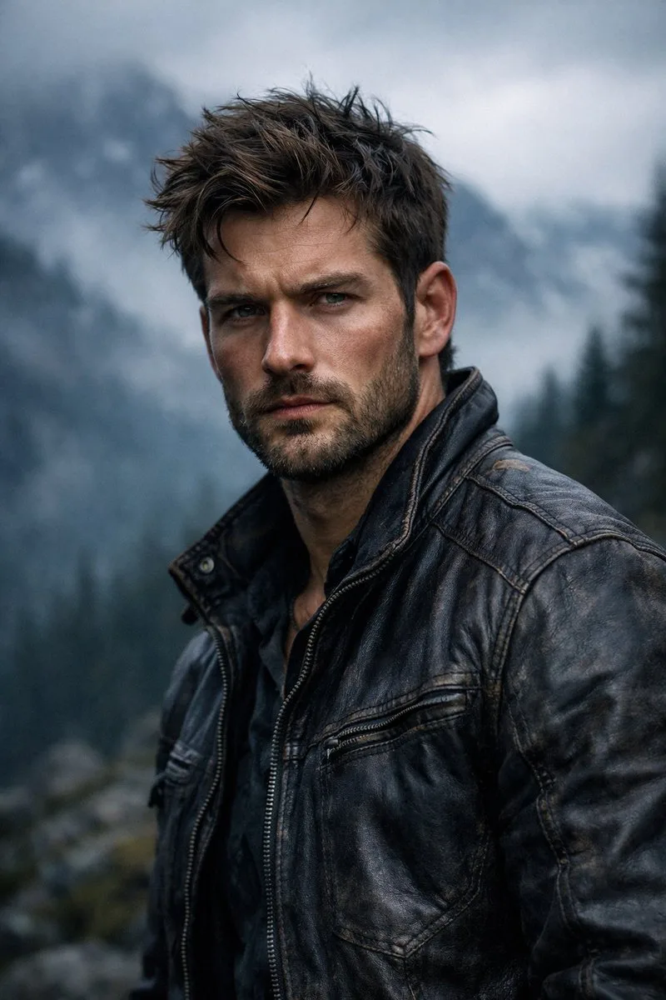

# Johnn — by @john_my07

[← Back to Community Examples](../../EXAMPLES.md) · Category: Photography · Model: `GPT Image`

<a href="https://x.com/john_my07/status/2001888275724984383"></a>

Source: **[@john_my07 on X](https://x.com/john_my07/status/2001888275724984383)** · Creator: [Johnn](https://x.com/john_my07)

## Prompt

```text
{
  "render_goal": "Create a hyper-realistic, cinematic portrait with a rugged outdoor adventure aesthetic",
  "subject": {
    "gender": "male",
    "age_range": "mid-to-late 20s",
    "appearance": {
      "hair": "textured, windswept",
      "beard": "short, well-groomed",
      "facial_features": "sharp, chiseled",
      "expression": "intense, serious"
    },
    "skin_detail": "ultra-detailed, natural texture with realistic tones"
  },
  "wardrobe": {
    "outerwear": "worn dark leather jacket",
    "details": "visible stitching, rugged texture"
  },
  "environment": {
    "location": "outdoor mountain landscape",
    "background": {
      "mountains": "misty, fog-covered",
      "trees": "dark evergreen forest fading into distance",
      "atmosphere": "dense atmospheric fog"
    }
  },
  "lighting_and_color": {
    "lighting_style": "moody, cinematic",
    "light_source": "soft overcast daylight",
    "shadows": "dramatic but natural",
    "color_palette": "cool, desaturated tones"
  },
  "camera_settings": {
    "lens": "85mm",
    "aperture": "f/1.8",
    "depth_of_field": "shallow",
    "focus": "razor-sharp on subject, blurred background"
  },
  "photography_style": {
    "quality": "professional photography",
    "realism_level": "hyper-realistic",
    "details": "high micro-detail, crisp textures, cinematic contrast"
  }
}
```

## Try it

Paste the prompt into **[vinano.ai](https://vinano.ai?utm_source=github&utm_medium=readme&utm_campaign=awesome-image-video-prompts-updating&utm_content=x-page-try)** to generate your own version.

> The image and prompt belong to @john_my07 ([original post](https://x.com/john_my07/status/2001888275724984383)) and are shown here with credit for reference. Creators can ask for changes or removal by opening an issue.
